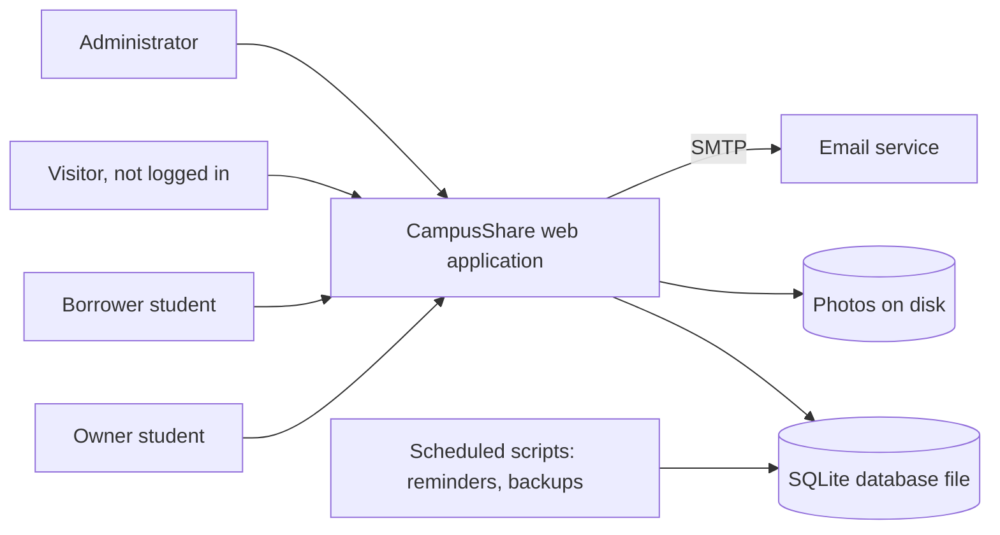
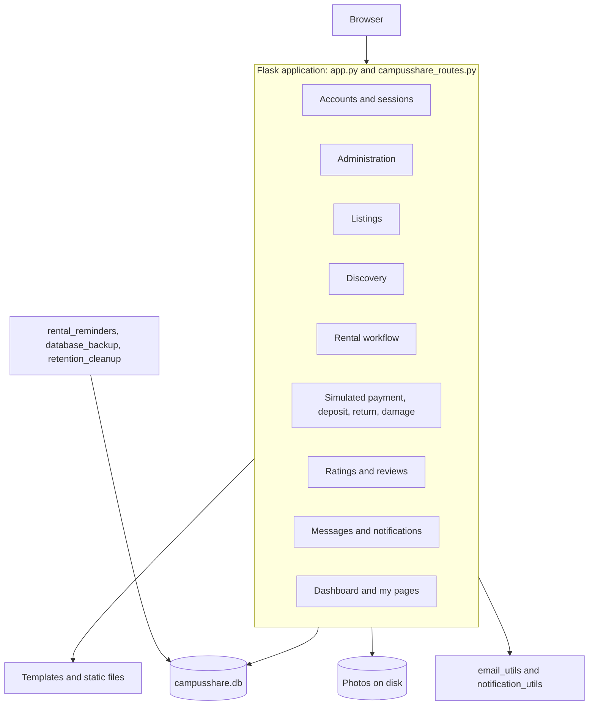
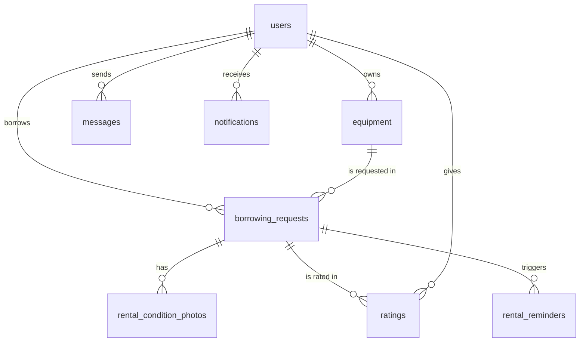
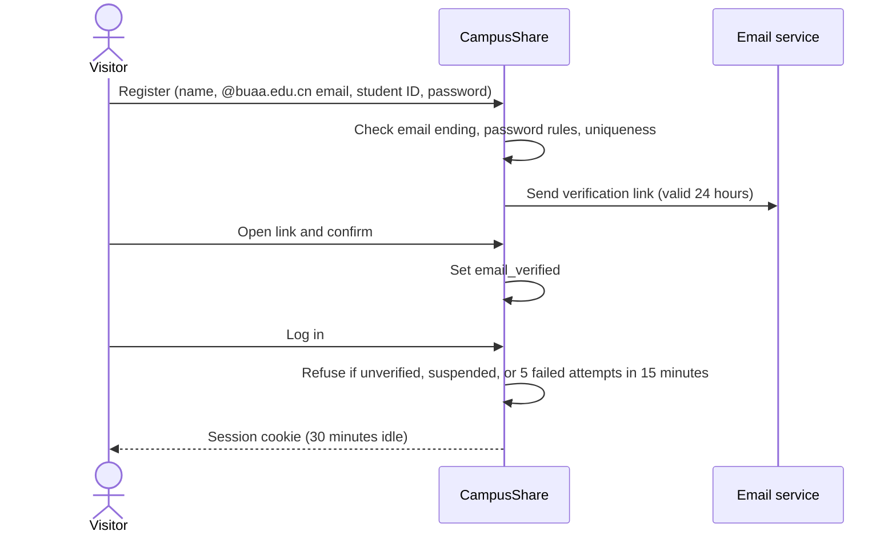
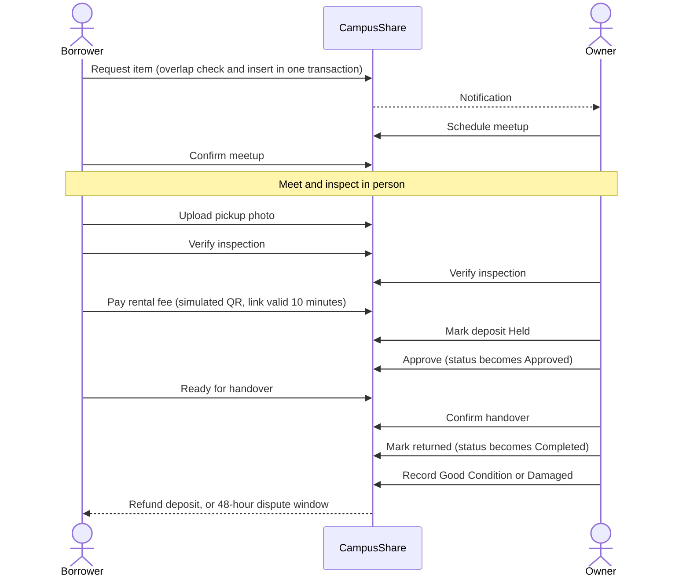
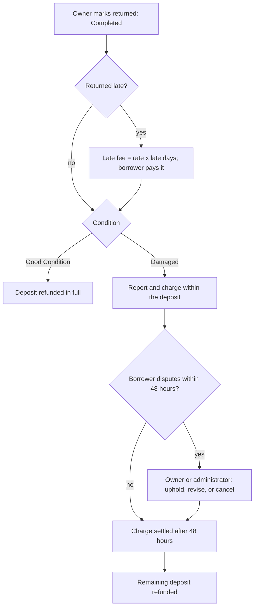
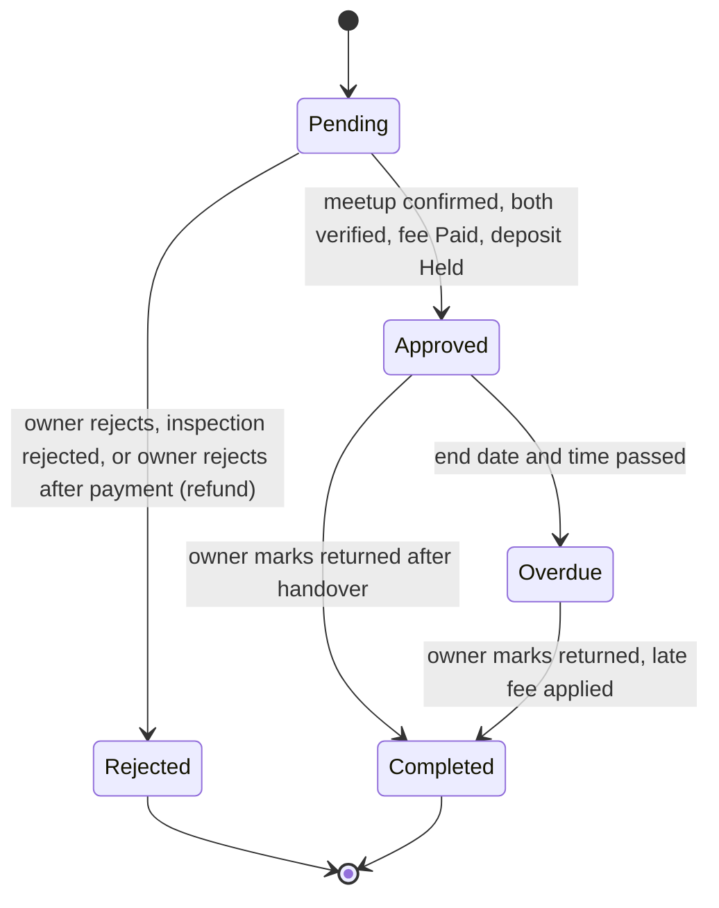
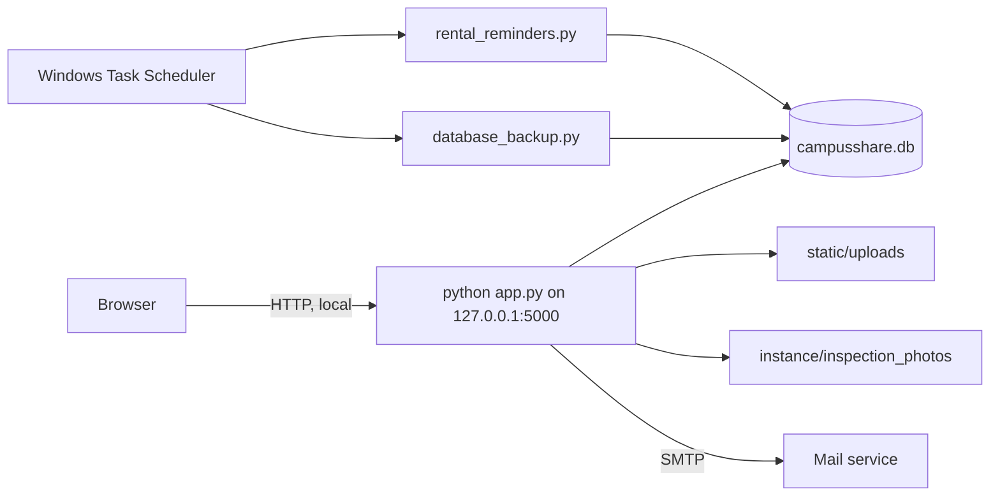
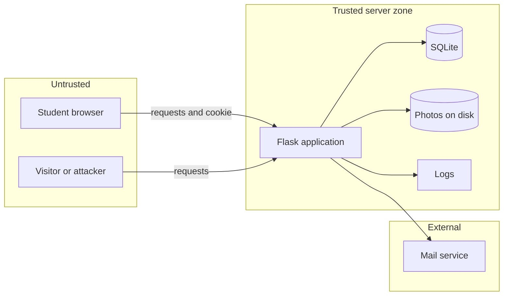
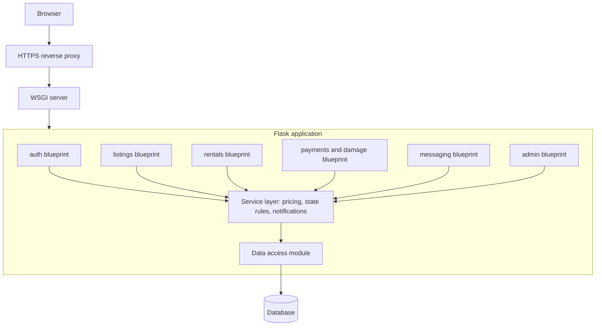

# CampusShare: Architecture and Design Description

| | |
|---|---|
| **Project** | CampusShare (Team 26F) |
| **Document** | Architecture and design description |
| **Version** | v1.0  |
| **Date** | 2026-11-24 |
| **Author** | Sandra Masiwa (system design and documentation) |
| **Team** | Turay Edward Joe (backend and business logic), Amanda Nancy Skaikay (requirements analysis and usability review), Sandra Masiwa (system design and documentation) |
| **Standard followed** | ISO/IEC/IEEE 42010:2022 (architecture description), structure adapted for a course project |
| **Baseline** | Branch `main`, snapshot `26F-main` dated 2026-11-17 (95 automated tests pass) |
| **Location** | `docs/design/design.md` |
| **Related documents** | [`SRS.md`](../requirements/SRS.md) v1.0, [`user-roles-and-permissions.md`](../requirements/user-roles-and-permissions.md) |

## Revision history

| Version | Date | Author | Change |
|---|---|---|---|
| v0.1 | 2026-10-22 | Sandra Masiwa | First draft from the first prototype (`app.py`, commit `2403816`) |
| v1.0 | 2026-11-24 | Sandra Masiwa | Rewritten for the current `main`: module structure, ten tables, meetup, inspection and handover workflow, simulated QR payment, damage disputes, administrator role, retention and backup scripts, updated security analysis, decisions and route inventory. Proposals from v0.1 are marked done or still open (section 6.2). Completed to the ISO/IEC/IEEE 42010 elements: documentation roadmap (1.4), viewpoint definitions (2.1), element and interface catalogs (4.6), correspondences between views (4.7), consistency statement (4.8), and a glossary (Appendix B) |

## Table of contents

1. [Introduction](#1-introduction)
2. [Stakeholders and concerns](#2-stakeholders-and-concerns)
3. [Architecture overview](#3-architecture-overview)
4. [Architectural views](#4-architectural-views)
5. [Security and trust design](#5-security-and-trust-design)
6. [Design decisions and rationale](#6-design-decisions-and-rationale)
7. [Future architecture (proposed)](#7-future-architecture-proposed)
8. [Traceability to the SRS](#8-traceability-to-the-srs)
9. [Limitations and known issues](#9-limitations-and-known-issues)
10. [Appendix A: Route inventory](#appendix-a-route-inventory)
11. [Appendix B: Glossary](#appendix-b-glossary)

---

## 1. Introduction

### 1.1 Purpose

This document describes the architecture and design of CampusShare, a web application where Beihang University students lend and borrow equipment. It explains how the system is organized, why, where its trust boundaries lie, and how each part meets the requirements in the SRS.

### 1.2 Scope

It covers the application, its database, its scheduled scripts, and its runtime environment. It does not cover the physical hand-over of items, which happens between students in person, or real payment, which is out of scope (the payment is simulated and the project is for academic purposes only).

### 1.3 Reading guide

- Statements marked **(code)** come from reading the source on `main`.
- Statements marked **(test)** are confirmed by an automated test.
- Statements marked **(proposed)** describe something that does not exist yet.
- IDs such as `FR-MTG-03` and `SEC-12` refer to the [SRS](../requirements/SRS.md).

### 1.4 Documentation roadmap

| If you want to... | Read | Section |
|---|---|---|
| Understand the system in five minutes | Overview and context view | 3, 4.1 |
| Review how the code is organized | Logical view, element catalog | 4.2, 4.6 |
| Check what is stored | Data view | 4.3 |
| Follow a workflow or a status change | Process view | 4.4 |
| Run or deploy it | Deployment view, interface catalog | 4.5, 4.6.2 |
| Judge the security | Security and trust design | 5 |
| Find why a choice was made | Design decisions | 6 |
| Check a requirement is covered | Traceability, correspondences | 8, 4.7 |
| Look up a route or a term | Appendices | A, B |

Each view in section 4 states which concerns it answers, uses one notation, and is tied to the other views in section 4.7.

---

## 2. Stakeholders and concerns

| Stakeholder | Concerns |
|---|---|
| Owner students | Easy listing, safe handling of items, fair damage and late-fee decisions, correct deposits |
| Borrower students | Finding items, clear prices and dates, protection from unfair charges, reminders |
| Administrator | Removing abusive listings or users, deciding disputes, seeing what happened |
| Development team | Code that is easy to change, test, and run on any laptop |
| Instructor and peer-review teams | Documentation that matches the running system and can be checked |
| Beihang University | Only genuine students use the service; student data is protected |

### 2.1 Viewpoint definitions

Each viewpoint fixes the concerns it frames, the kinds of model it uses, and the notation. A view in section 4 is one application of a viewpoint to CampusShare.

| Viewpoint | Concerns it frames | Main stakeholders | Model kinds | Notation | View |
|---|---|---|---|---|---|
| Context | What is inside the system and what it talks to | All | System boundary, external parties | Mermaid flowchart | 4.1 |
| Logical | How the code is divided and who depends on whom | Developers, reviewers | Components, responsibilities, dependencies | Mermaid flowchart, tables | 4.2, 4.6 |
| Data | What is stored, how it relates, and which values are allowed | Developers, reviewers, administrator | Entities, relationships, value sets | Mermaid ER diagram, tables | 4.3 |
| Process | How workflows run and how rental status changes | Owners, borrowers, developers | Sequences, state machines, flows | Mermaid sequence, state and flow diagrams | 4.4 |
| Deployment | Where the parts run, how they are configured and scheduled | Developers, instructor | Nodes, files, variables, schedules | Mermaid flowchart, tables | 4.5 |
| Security and trust | Assets, trust boundaries, threats, controls | Administrator, university, reviewers | Trust boundaries, STRIDE table, control list | Mermaid flowchart, tables | 5 |

Conventions: boxes are components or stores, arrows show the direction of a request or data flow, requirement IDs such as `FR-MTG-03` link a model element to the [SRS](../requirements/SRS.md), and "(code)", "(test)", and "(proposed)" mark the evidence for a statement (section 1.3).

---

---

## 3. Architecture overview

CampusShare is a **monolithic, server-rendered web application** **(code)**:

- **Flask** receives browser requests, runs the logic, and returns HTML from **Jinja2 templates** (27 files in `templates/`). Static files are in `static/`.
- **SQLite** holds all data in one file, `campusshare.db`, created by `init_db()` on first start. Every connection comes from `database.connect_database`, which turns on foreign keys.
- **Sessions** are Flask signed cookies (HttpOnly, SameSite Lax, 30 minutes idle).
- **Flask-WTF** adds a CSRF token to every state-changing form.
- Every route opens its own database connection, runs parameterized SQL, and closes it. Multi-step changes use `BEGIN IMMEDIATE` so SQLite allows one writer at a time.

The code is split into small modules, but the routes are still in one file:

| File | Responsibility | Size |
|---|---|---|
| `app.py` | Configuration, security settings, HTTPS hooks, schema (`init_db`), error pages, unread-count context processors, start-up | about 810 lines |
| `campusshare_routes.py` | Every route, plus validation, pricing, and rental-state logic | about 5,350 lines |
| `database.py` | `connect_database` with `PRAGMA foreign_keys = ON` | 8 lines |
| `email_utils.py` | SMTP sending (verification, reset, notification emails) | |
| `notification_utils.py` | `create_notification`: in-app row, plus email if the user opted in | |
| `rental_reminders.py` | Scheduled script: reminder one day before the end date | |
| `retention_cleanup.py` | Manual script: preview or apply data retention rules | |
| `database_backup.py` | Script: consistent SQLite backup | |
| `install_*.ps1` | Windows scheduled tasks for reminders and backups | |
| `performance_test.py` | In-process benchmark (1,000 listings, 50 workers) | |

**Start-up wiring (code).** `app.py` creates the Flask object, then imports `campusshare_routes` near the end, which registers the routes on that object. The routes module imports `app` back. When `app.py` is run directly, it first registers itself as module `app` so both files share one Flask instance (`test_running_app_py_registers_routes_on_the_server_instance`). `FLASK_SECRET_KEY` is required; the application refuses to start without it (SEC-04).

The cost of this layout is that logic, data access, and presentation choices sit together in one large file. Section 7 proposes a split.

---

## 4. Architectural views

### 4.1 Context view

Users reach the application through a browser. The simulated QR payment is served by the application itself and is not an external system. The only external system is an SMTP mail service, configured at deployment (FR-EXT-03).

### 4.2 Logical view: components

| Component | Responsibility | Main routes |
|---|---|---|
| Accounts and sessions | Register with email confirmation, log in with lockout, log out, reset password, delete account | `/register`, `/login`, `/verify-email/<token>`, `/resend-verification`, `/logout`, `/forgot-password`, `/reset-password/<token>`, `/account/delete` |
| Administration | Remove listings, suspend or restore users, see open disputes | `/admin`, `/admin/listings/<id>/remove`, `/admin/users/<id>/suspension` |
| Listings | Create, edit, delete, photo upload, hourly window | `/list-item`, `/edit-listing/<id>`, `/delete-listing/<id>`, `/my-listings` |
| Discovery | Browse, search, filter, paginate, detail page | `/`, `/browse`, `/equipment/<id>` |
| Rental workflow | Request, owner reject, meetup, pickup photo, inspection, approve, handover | `/request-equipment/<id>`, `/requests/<id>/schedule-meetup`, `.../confirm-meetup`, `/rentals/<id>/inspection-photo`, `.../verify-inspection`, `.../reject-inspection`, `/requests/<id>/approve`, `.../reject`, `/rentals/<id>/ready-for-handover`, `/requests/<id>/confirm-handover` |
| Payment, deposit, return, damage | QR payment, deposit Held, return, late fee, damage report, dispute, settlement, refund | `/qr-payment/...`, `/confirm-deposit/<id>`, `/requests/<id>/complete`, `/pay-late-fee/<id>`, `/damage-status/<id>/<condition>`, `/damage-dispute/<id>`, `/damage-dispute/<id>/resolve`, `/settle-damage/<id>`, `/refund-deposit/<id>` |
| Ratings | Two-way reviews after completion | `/rate/<id>`, `/my-reviews` |
| Messages and notifications | Direct messages, notification list, email preference | `/chat/<id>`, `/messages`, `/delete-message/<id>`, `/students`, `/notifications...` |
| Dashboard and lists | Per-user summaries | `/dashboard`, `/my-rentals`, `/requests` |

The full route list is in Appendix A.

### 4.3 Data view

| Table | Key contents |
|---|---|
| `users` | name, unique email and student ID, password hash, `email_verified`, `role` (`user` or `admin`), `suspended`, `deleted_at`, `notification_emails_enabled` |
| `equipment` | owner, name, category, description, condition, sharing type, price and unit (day or hour), deposit, availability dates, pickup and return times, location, `image_path`, `is_removed` |
| `borrowing_requests` | equipment, borrower, dates and times, saved unit price and total, `status`, meetup fields (time, place, status, both inspection confirmations, rejection reason), `payment_status`, `deposit_status`, late fee and its status, damage status, report, charge and time, dispute status, reason and resolution, borrower-ready and handover times |
| `rental_condition_photos` | request, uploader, stage (`pickup` or `return`), path, time |
| `ratings` | request, rater, rated user, rating 1 to 5, comment; unique per request and rater |
| `messages` | sender, receiver, text, read flag, time |
| `notifications` | user, message, link, read flag, time |
| `rental_reminders` | request and reminder type (primary key stops duplicates) |
| `login_attempts`, `verification_email_attempts` | email, IP address, time (throttling) |

All foreign keys are enforced (NFR-REL-01, tests). `add_missing_columns` adds new columns to an older database on start-up, which keeps old files working without a migration tool.

**Value sets (code).**

| Field | Values |
|---|---|
| Request `status` | Pending, Approved, Rejected, Overdue, Completed |
| `payment_status` | Unpaid, Paid |
| `deposit_status` | Pending, Held, Refunded, Settled |
| `meetup_status` | Not Scheduled, Proposed, Confirmed |
| `damage_status` | Not Checked, Good Condition, Damaged |
| `damage_dispute_status` | Not Disputed, Pending, Upheld, Revised, Cancelled |
| `late_fee_status` | Unpaid, Paid |

The request `status` holds only five values. The finer stages of a rental are held in the other columns, so a rental's stage is the combination of columns, not one field.

**Files outside the database.** Listing photos are in `static/uploads/` and are public. Pickup condition photos are in `instance/inspection_photos/` and are served only by `/inspection-photos/<id>` to the borrower and owner, with `Cache-Control: private, no-store`. Backups go to `backups/`.

### 4.4 Process view

#### 4.4.1 Registration and login

#### 4.4.2 Main borrowing flow

The full sequence with requirement IDs is in SRS section 4.2. The design view of it:

Each step is an HTTP POST that checks, inside one transaction, that the actor is the right person and that the request is in the right state. A step in the wrong order is refused with HTTP 409 (test: approval before deposit, return and handover before approval).

#### 4.4.3 Return, damage, and dispute

A cancelled dispute allows a refund but not a settlement (test).

#### 4.4.4 Request status machine

**Overdue marking (code).** `mark_overdue_rentals` runs as a `before_request` hook, so every web request first moves due rentals from Approved to Overdue and creates the overdue notice. There is no background process for it. The cost is that the change appears on the first request after the deadline. A rental waiting for handover is never marked Overdue (test).

### 4.5 Deployment view

**Configuration (environment variables).**

| Variable | Purpose | Required |
|---|---|---|
| `FLASK_SECRET_KEY` | Signs cookies and tokens | Yes; the application will not start without it |
| `CAMPUSSHARE_ADMIN_EMAILS` | Comma-separated administrator emails | No |
| `CAMPUSSHARE_SMTP_HOST`, `_FROM`, `_PORT`, `_USERNAME`, `_PASSWORD`, `_SECURITY` | Mail service (`starttls` or `ssl`) | For real email |
| `CAMPUSSHARE_ENV` | Meant to switch on HTTPS redirect and HSTS | Not effective (see 9) |

**How to run.** Create a virtual environment, install `requirements.txt` (Flask, Flask-WTF, qrcode with Pillow), set `FLASK_SECRET_KEY`, run `python app.py`, open `http://127.0.0.1:5000`. The built-in server is for local use only. Tests run with `python -m unittest discover -s tests -v`.

**Scheduling.** Scripts for Windows Task Scheduler exist. On macOS and Linux the team must schedule `rental_reminders.py` (daily) and `database_backup.py` (daily) with cron. `retention_cleanup.py` is run by hand; it shows a preview unless `--apply` is given.

### 4.6 Element catalog

#### 4.6.1 Components

| Component | Responsibilities | Provides | Uses | Main data |
|---|---|---|---|---|
| Accounts and sessions | Register, confirm email, log in with lockout, log out, reset password, delete account | Web pages and forms (I-01) | `email_utils` (I-02), database | `users`, `login_attempts`, `verification_email_attempts` |
| Administration | Remove listings, suspend users, decide disputes | Admin pages (I-01) | Notifications, database | `users` (role, suspended), `equipment` (removed), disputes in `borrowing_requests` |
| Listings | Create, edit, delete listings; photo upload; hourly window | Listing forms (I-01) | File system (I-05), database | `equipment`, `static/uploads` |
| Discovery | Browse, search, filter, paginate, show details | Public pages (I-01) | Database | `equipment`, derived availability |
| Rental workflow | Request, meetup, pickup photo, inspection, approval, handover | Rental pages and actions (I-01) | Notifications, file system (I-05), database | `borrowing_requests`, `rental_condition_photos` |
| Payment, deposit, return, damage | Simulated QR payment, deposit, return, late fee, damage report, dispute, settlement, refund | Payment pages (I-01), signed links (I-03) | Notifications, database | `borrowing_requests` |
| Ratings | Two-way reviews, average rating | Review pages (I-01) | Database | `ratings` |
| Messages and notifications | Direct messages, in-app notices, optional email | Message and notice pages (I-01) | `notification_utils`, `email_utils` (I-02) | `messages`, `notifications` |
| Scheduled scripts | Return reminders, backups, retention cleanup | Command line (I-06) | Database, notifications | `rental_reminders`, whole database |

#### 4.6.2 Interfaces

| ID | Interface | Parties | Protocol and form | Trust and protection | SRS |
|---|---|---|---|---|---|
| I-01 | Web interface | Browser and application | HTTP forms and HTML pages | Signed session cookie, CSRF token, server-side checks | SEC-05, SEC-06, SEC-08 |
| I-02 | Email | Application and SMTP service | SMTP with STARTTLS or SSL, credentials from environment | Failures are logged and never block the action | FR-EXT-03 |
| I-03 | Signed links | Email or QR code and application | URL with a signed, time-limited token (verification, reset, QR payment) | Secret key; QR links valid 10 minutes; reset links single use | SEC-11, FR-EXT-07 |
| I-04 | Database | Application and scripts and SQLite file | `sqlite3` with foreign keys on | Parameterized SQL | SEC-10, NFR-REL-01 |
| I-05 | File storage | Application and disk | Public `static/uploads`; private `instance/inspection_photos` | Content-type check, size limit, access check on private photos | FR-LST-07, FR-MTG-05 |
| I-06 | Scheduler | Operating system and scripts | Command line (`rental_reminders.py`, `database_backup.py`, `retention_cleanup.py`) | Run by the machine owner | FR-EXT-06, FR-DAT-02 |
| I-07 | Logs | Application and log output | Text lines | Tokens and credentials redacted | SEC-14, SEC-16 |

### 4.7 Correspondences between views

| Component (4.2) | Tables (4.3) | Processes (4.4) | Runs as (4.5) | Security (5) | SRS area (8) |
|---|---|---|---|---|---|
| Accounts and sessions | `users`, `login_attempts`, `verification_email_attempts` | 4.4.1 | Web process | Spoofing controls, throttling | Accounts |
| Administration | `users`, `equipment`, `borrowing_requests` | 4.4.3 | Web process | Role from allowlist | Administration |
| Listings | `equipment` | | Web process, `static/uploads` | Upload checks | Listings |
| Discovery | `equipment` | | Web process | Names only for other users | Browse |
| Rental workflow | `borrowing_requests`, `rental_condition_photos` | 4.4.2, 4.4.4 | Web process, private photo folder | State and actor checks | Requests, meetup |
| Payment, deposit, return, damage | `borrowing_requests` | 4.4.2, 4.4.3, 4.4.4 | Web process | Signed QR link, ownership checks | Payment |
| Ratings | `ratings` | 4.4.2 | Web process | One review per rater and rental | Ratings |
| Messages and notifications | `messages`, `notifications` | | Web process, SMTP | Sender-only deletion | Messages, notifications |
| Scheduled scripts | `rental_reminders`, all tables | | Task Scheduler or cron | Run locally | Reminders, retention |

### 4.8 Consistency statement

The views agree on these points. They were checked on 2026-11-24.

| Rule | Check |
|---|---|
| Every route in Appendix A belongs to one component in 4.2 | The 54 routes in Appendix A match the 54 route paths in `campusshare_routes.py` exactly |
| Every table in 4.3 has an owning component in 4.6 and a row in 4.7 | Ten tables in `init_db`; all appear in 4.7 |
| Status values in 4.3, the state machine in 4.4.4, and SRS section 3.5 are the same | Same five request statuses and the same value sets |
| The workflow in 4.4.2 matches SRS section 4.2 | Same order of steps |
| Every requirement group in the SRS maps to a component and a test (section 8) | See section 8 |

Known inconsistency: the application does not read the HTTPS production switch described in `CAMPUSSHARE_PROGRESS.md` (section 9, item 1). The documents describe the code as it is.

---

## 5. Security and trust design

### 5.1 Assets

| Asset | Why it matters |
|---|---|
| Accounts and sessions | Control of an account means control of its listings, rentals, and messages |
| Personal data: name, email, student ID | Privacy of real students |
| Rental, deposit, and damage records | Basis of money-related decisions between students |
| Pickup photos | Evidence in a damage dispute |
| Messages | Private conversations |
| Secret key | Signs cookies, verification, reset, and payment tokens |

### 5.2 Trust boundaries

Everything from a browser (form fields, URL parts, cookies, uploaded files) is untrusted. The server is the only place where rules are enforced; a disabled button or date picker is not a control.

### 5.3 Threat analysis (STRIDE)

| Threat | Scenario | Control now in place | SRS | Residual risk |
|---|---|---|---|---|
| **Spoofing** | Registering with a made-up university email | Verification link sent to the address, valid 24 hours | SEC-01 | Student ID is not checked against any source |
| **Spoofing** | Forged cookie or token | Secret key from the environment; signed, time-limited tokens | SEC-04 | Anyone holding the key can forge tokens |
| **Spoofing** | Password guessing | 8 to 128 characters, common-password list, lock after 5 failures in 15 minutes | SEC-02, SEC-07 | Lockout can be used to annoy one account |
| **Tampering** | Forged form posted from another site | CSRF token on all state-changing requests; logout is POST only | SEC-05 | None known |
| **Tampering** | Calling routes out of order | Each route checks the actor and the state in its SQL; invalid transitions return 409 | SEC-08, FR-REQ-08 | Checks are per route, with no central guard; some are tested only manually |
| **Tampering** | Borrower marks own rental Paid | Payment is recorded only through the signed QR confirmation by the borrower | FR-EXT-07 | Payment is simulated, so it proves nothing about real money |
| **Tampering** | Uploading a script as a photo | Type checked by file content, 5 MB limit, image re-encoded | FR-LST-07 | None known |
| **Repudiation** | An owner denies a charge or a borrower a payment | Security events logged without secrets; dispute outcomes stored | SEC-16 | Logs are plain files, 90-day retention is not automated |
| **Information disclosure** | Reading other users' emails or IDs | Other users see names only | SEC-13 | None known |
| **Information disclosure** | Tokens in logs | Redaction filter for verification, reset, and payment links; exceptions logged by type only | SEC-14 | Tested for tokens, not for every field |
| **Information disclosure** | Learning which emails exist | Same response for known and unknown emails | SEC-11 | None known |
| **Information disclosure** | Reading someone's pickup photos | Served only to borrower and owner, not cached | FR-MTG-05 | Administrator cannot see them in a dispute |
| **Information disclosure** | Script injection through user text | Template auto-escaping, no `safe` filter | SEC-15 | One `render_template_string` with a fixed template |
| **Denial of service** | Heavy load or large uploads | 5 MB request limit; resend and login throttles; in-process p95 of 1.07 s at 50 workers | NFR-PERF-01 | SQLite single writer; no real-network test |
| **Elevation of privilege** | Acting on another user's rental | Ownership checks (see Tampering) | SEC-08 | As above |
| **Elevation of privilege** | Becoming administrator | Role set only from the configured email list, never at registration | FR-ADM-01 | Anyone controlling an allowlisted mailbox |

### 5.4 Trust design: how students come to trust each other

| Trust question | Design |
|---|---|
| Is this a real Beihang student? | University email must be confirmed. Student ID is recorded but not verified (accepted limitation) |
| Can I rely on this person? | Two-way 1 to 5 star reviews after each completed rental; average shown on the dashboard |
| Is the item as described? | Meetup in person, pickup photo, both parties verify before any payment |
| What if the item comes back damaged? | Owner records damage and a charge within the deposit; borrower has 48 hours to dispute; owner or administrator decides; the pickup photo is the reference |
| What if it is late? | Automatic Overdue status, reminders, late fee of the saved rate per late day |
| Who settles disputes or removes bad actors? | Administrator can resolve disputes, remove listings, and suspend accounts, without deleting history |
| Is my private information safe? | Names only are shown; passwords hashed; data retention script; account deletion keeps only what the other party needs |

### 5.5 Security controls summary

| Control | Status | SRS |
|---|---|---|
| Email confirmation | In place | SEC-01 |
| Password rules and salted hashing | In place | SEC-02, SEC-03 |
| Secret key from configuration | In place | SEC-04 |
| CSRF protection | In place | SEC-05 |
| Session timeout and cookie flags | In place | SEC-06 |
| Login attempt limit | In place | SEC-07 |
| Ownership and state checks | Partial | SEC-08 |
| Input validation | Partial | SEC-09 |
| Parameterized SQL | In place | SEC-10 |
| Reset links single-use, neutral reply | In place | SEC-11 |
| Loopback binding; HTTPS in deployment | Partial: production switch is not wired | SEC-12 |
| Names only for other users | In place | SEC-13 |
| No secrets in logs | In place | SEC-14 |
| Output escaping | In place | SEC-15 |
| Security event log | In place | SEC-16 |

---

## 6. Design decisions and rationale

### 6.1 Decisions as built

| ID | Decision | Rationale | Consequence |
|---|---|---|---|
| D-01 | One Flask application with server-rendered pages; routes in one module | Quick to build, run, and demonstrate | A 5,350-line routes file is hard to review (G-28) |
| D-02 | SQLite file database with foreign keys on | No installation; enough for a campus demo | One writer at a time; no migration tool, only `add_missing_columns` |
| D-03 | One account type; owner and borrower roles come from the listing or request; an `admin` role from an email allowlist | A student is often both lender and borrower | Every route must check the actor itself |
| D-04 | Signed cookie sessions, 30-minute idle timeout | Built into Flask | Security rests on the secret key |
| D-05 | Rental stage kept as several columns on one row, with a five-value `status` | One table covers the life of a rental | Valid combinations are enforced in SQL conditions, not by one state function |
| D-06 | Hourly and daily pricing; hourly time rounded up to whole hours; unit price and total saved at request time | Simple and predictable | Later price edits do not change a request |
| D-07 | Payment is simulated by a signed QR link valid 10 minutes; deposit is marked Held by the owner | No payment gateway is available; project is academic | "Paid" proves nothing about real money |
| D-08 | In-person meetup, pickup photo, and verification by both parties before payment and approval | Builds trust and gives evidence for disputes (peer-review findings F-01, F-11) | More steps for users |
| D-09 | Overdue is detected by a hook on each request | No scheduler needed on any machine | Status changes at the next request, not at the exact time |
| D-10 | Reminders, backups, and retention cleanup are separate scripts | Keeps the web process simple | Need a scheduler; Windows scripts only |
| D-11 | Damage charge waits 48 hours; owner or administrator decides a dispute | Fair to the borrower; avoids a dead end if the owner does not act | Slower settlement |
| D-12 | Equipment status (Available, Pending, Booked) is derived from requests, not stored | Avoids two values going out of step | Extra queries; a listing with one booking shows Booked (G-30) |
| D-13 | Pickup photos stored outside `static/` and served through a checked route | Private evidence | Not in the database backup |

### 6.2 Proposals from v0.1: where they stand

| ID | Proposal | State |
|---|---|---|
| P-01 | Split the app into blueprints and a data-access module | Open (section 7) |
| P-02 | Secret key and settings from environment variables | Done (secret key, admin list, SMTP). Production switch not wired |
| P-03 | One status-change function | Not done; conditions are in each route's SQL |
| P-04 | CSRF protection | Done |
| P-05 | Rate limiting on login and reset | Done (database-backed counters) |
| P-06 | Email confirmation and reset links | Done |
| P-07 | Foreign keys on; block deletion of listings with history | Done |
| P-08 | One login guard and one ownership check | Not done; checked per route |
| P-09 | `role` column | Done |
| P-10 | Date and time for availability and rentals | Done |
| P-11 | Audit log | Done as log lines (SEC-16), not a table |
| P-12 | Bind to 127.0.0.1; HTTPS for shared use | Binding done; HTTPS switch not wired |

---

## 7. Future architecture (proposed)

These are proposals only and are not required for the course deliverable.

| Step | Change | Benefit |
|---|---|---|
| 1 | Read `CAMPUSSHARE_ENV` and the trusted-proxy count from the environment; apply proxy-header handling | HTTPS controls actually work (SEC-12) |
| 2 | Split `campusshare_routes.py` into blueprints, with the pricing and state rules in a service module | Smaller files, unit-testable rules (NFR-MNT-02) |
| 3 | One decorator for login and role, one function for state changes | Removes per-route differences (SEC-08) |
| 4 | Let the administrator open pickup photos in a dispute; notify on inspection rejection | Closes two SRS gaps |
| 5 | Move to a server database only if load grows beyond a campus pilot | Concurrency |
| 6 | Real payment provider | Out of scope for the course |

---

## 8. Traceability to the SRS

| SRS area | Requirements | Design element | Tests (examples) |
|---|---|---|---|
| Accounts | FR-AUTH-01 to 07, SEC-01, 02, 07, 11 | Accounts component; `users`, `login_attempts`, `verification_email_attempts`; `email_utils` | `test_registration_requires_verification_before_login`, `test_login_throttles_repeated_failures_and_clears_after_success` |
| Listings and browse | FR-LST-01 to 09, FR-BRW-01 to 06 | Listings and Discovery; `equipment`; `static/uploads` | `test_listing_photo_upload_rejects_fake_image_content`, `test_browse_paginates_and_keeps_search_filters` |
| Requests and pricing | FR-REQ-01 to 12 | Rental workflow; `borrowing_requests`; `BEGIN IMMEDIATE`; overdue hook | `test_hourly_request_rounds_up_and_requires_one_hour_minimum`, `test_unreturned_rental_is_marked_overdue_and_can_be_completed` |
| Meetup, inspection, handover | FR-MTG-01 to 07 | Rental workflow; `rental_condition_photos`; meetup columns | `test_borrower_request_approval_and_demo_payment`, `test_handover_roles_and_replay_are_enforced` |
| Payment, deposit, damage | FR-PAY-01 to 15, FR-EXT-07 | Payment component; signed QR tokens; deposit, damage, dispute columns | `test_deposit_requires_paid_pending_request_and_can_only_be_held_once`, `test_owner_can_uphold_or_cancel_a_disputed_damage_charge` |
| Ratings | FR-RAT-01 to 04 | Ratings; `ratings` | `test_borrower_and_owner_can_review_each_other_once_after_completion` |
| Messages and notifications | FR-MSG-01 to 06, FR-NTF-01 to 07 | Messages; `messages`, `notifications`, `rental_reminders`; `notification_utils` | `test_only_message_sender_can_delete_message`, `test_notification_email_is_opt_in_and_sent_to_recipient` |
| Administration | FR-ADM-01 to 04 | Administration; `users.role`, `users.suspended` | `test_administrator_can_resolve_open_damage_dispute` |
| Data retention | FR-DAT-01, 02 | `retention_cleanup.py`; `/account/delete` | `test_retention_cleanup_applies_only_eligible_rows` |
| Security | SEC-03 to 06, 08 to 10, 12 to 16 | Section 5 | `test_login_session_timeout_and_cookie_security_attributes`, `test_exception_and_access_logs_do_not_expose_tokens` |
| Reliability and performance | NFR-REL-01, 02, NFR-PERF-01 | `database.py`, `database_backup.py`, `performance_test.py` | `test_sqlite_foreign_keys_are_enabled_on_application_connections`, `test_backup_is_a_valid_copy_of_the_source_database` |

---

## 9. Limitations and known issues

| # | Limitation | Effect | SRS |
|---|---|---|---|
| 1 | The production switch is not wired. `CAMPUSSHARE_ENV` is read only from `app.config`, nothing sets it from the environment, and no proxy-header handling or hop count is read | Behind an HTTPS proxy, no redirect, no HSTS, and cookies are not marked Secure | SEC-12 |
| 2 | Student ID is stored but not verified | A person with any university mailbox can register | SEC-01 |
| 3 | Payment is simulated | No real money moves | FR-EXT-07 |
| 4 | Administrator cannot open pickup photos | A dispute decision lacks the evidence | FR-MTG-05 |
| 5 | Rejecting an inspection sends no notification and has no test | The other party may not notice | FR-MTG-04 |
| 6 | Countdown shows days only | Hourly rentals show "due today" | FR-REQ-10 |
| 7 | Reminders and backups have Windows scripts only; photos are not in the backup | Manual setup on other systems | FR-EXT-06, NFR-REL-02 |
| 8 | All routes in one file; ownership checks are repeated per route | Harder to review | NFR-MNT-02, SEC-08 |
| 9 | A listing with one booking shows Booked for all dates | May mislead borrowers | FR-LST-06 |
| 10 | Performance measured in-process only | No deployment figure | NFR-PERF-01 |

---

## Appendix A: Route inventory

Access: **Public** = no login; **Login** = any logged-in user; **Owner**, **Borrower** = the owner of the listing or the borrower of the request; **Admin** = administrator; **Token** = signed link.

| Route | Methods | Access | Purpose |
|---|---|---|---|
| `/` | GET | Public | Home page |
| `/register` | GET, POST | Public | Create account, send verification email |
| `/login` | GET, POST | Public | Log in, with lockout |
| `/resend-verification` | GET, POST | Public | New verification email, limited per hour |
| `/verify-email/<token>` | GET, POST | Token | Confirm email |
| `/logout` | POST | Login | End session |
| `/forgot-password` | GET, POST | Public | Request reset link |
| `/reset-password/<token>` | GET, POST | Token | Set new password, once |
| `/account/delete` | GET, POST | Login | Delete account, with password |
| `/admin` | GET | Admin | Open disputes, listings, users |
| `/admin/listings/<id>/remove` | POST | Admin | Remove a listing from view |
| `/admin/users/<id>/suspension` | POST | Admin | Suspend or restore a user |
| `/dashboard` | GET | Login | Summary and unread counts |
| `/list-item` | GET, POST | Login | Create listing |
| `/edit-listing/<id>` | GET, POST | Owner | Edit listing and photo |
| `/delete-listing/<id>` | POST | Owner | Delete a listing with no history |
| `/my-listings` | GET | Login | Own listings |
| `/browse` | GET | Public | Search, filter, paginate |
| `/equipment/<id>` | GET | Public | Detail page |
| `/request-equipment/<id>` | POST | Login | Request an item |
| `/requests` | GET | Login | Requests on own listings |
| `/my-rentals` | GET | Login | Own borrowing requests |
| `/requests/<id>/reject` | POST | Owner | Reject while Pending, refund if paid |
| `/requests/<id>/schedule-meetup` | POST | Owner | Propose meetup |
| `/requests/<id>/confirm-meetup` | POST | Borrower | Confirm meetup |
| `/rentals/<id>/inspection-photo` | POST | Borrower | Upload pickup photo |
| `/inspection-photos/<id>` | GET | Owner or Borrower | View a pickup photo |
| `/rentals/<id>/verify-inspection` | POST | Owner or Borrower | Verify inspection |
| `/rentals/<id>/reject-inspection` | POST | Owner or Borrower | Reject inspection with reason |
| `/qr-payment/<id>` | GET | Borrower | Payment page and QR |
| `/qr-payment/image/<token>` | GET | Token | QR image |
| `/qr-payment/demo-preview/<id>` | GET | Borrower | Preview only; changes nothing |
| `/qr-payment/confirm/<token>` | GET, POST | Borrower, Token | Record rental fee as Paid |
| `/confirm-deposit/<id>` | POST | Owner | Mark deposit Held |
| `/requests/<id>/approve` | POST | Owner | Approve |
| `/rentals/<id>/ready-for-handover` | POST | Borrower | Confirm readiness |
| `/requests/<id>/confirm-handover` | POST | Owner | Confirm handover |
| `/requests/<id>/complete` | POST | Owner | Mark returned, compute late fee |
| `/pay-late-fee/<id>` | POST | Borrower | Pay late fee |
| `/damage-status/<id>/<condition>` | POST | Owner | Record Good Condition or Damaged |
| `/damage-dispute/<id>` | POST | Borrower | Dispute within 48 hours |
| `/damage-dispute/<id>/resolve` | POST | Owner or Admin | Uphold, revise, or cancel |
| `/settle-damage/<id>` | POST | Owner | Apply charge to deposit |
| `/refund-deposit/<id>` | POST | Owner | Record deposit refund |
| `/rate/<id>` | GET, POST | Borrower or Owner | Review the other party |
| `/my-reviews` | GET | Login | Reviews received |
| `/students` | GET | Login | Names of other users |
| `/chat/<id>` | GET, POST | Login | Conversation |
| `/requests/<id>/message-borrower` | GET | Owner | Open a chat with the borrower |
| `/messages` | GET | Login | Conversation list |
| `/delete-message/<id>` | POST | Sender | Delete own message |
| `/notifications` | GET | Login | Notification list |
| `/notifications/<id>/read` | POST | Login | Mark own notice read |
| `/notifications/email-preference` | POST | Login | Opt in or out of email notices |

---

## Appendix B: Glossary

| Term | Meaning |
|---|---|
| Borrower | The student who requests an item |
| Owner | The student who lists an item and decides on its requests |
| Administrator | A user whose email is on the configured list; can remove listings, suspend users, and decide disputes |
| Request | One borrowing request; also called a rental once it is approved |
| Meetup | The in-person meeting where owner and borrower inspect the item |
| Pickup photo | The photo of the item's condition, taken at the meetup before payment |
| Inspection verification | Each party's confirmation that the item matches its description |
| Deposit | The security amount held for damage or loss; not part of the rental fee |
| Held, Refunded, Settled | Deposit states: Held after the owner confirms it; Refunded when returned; Settled when a damage charge is applied |
| Late fee | Charge for returning after the end date: the saved rate times the late days |
| Overdue | Request status for an approved rental past its end date and not returned |
| Dispute window | 48 hours after a damage report in which the borrower can dispute the charge |
| QR payment | The simulated payment: a QR code that opens a signed confirmation link valid for 10 minutes |
| CSRF | Cross-site request forgery; blocked by a secret token on each form |
| STRIDE | Threat categories: Spoofing, Tampering, Repudiation, Information disclosure, Denial of service, Elevation of privilege |
| SRS | Software Requirements Specification, `docs/requirements/SRS.md` |
| ISO/IEC/IEEE 42010 | The standard for architecture descriptions (stakeholders, viewpoints, views, rationale) |
| Blueprint | A Flask feature for splitting routes into modules |
| SMTP | The protocol used to send email |
| HSTS | A header telling browsers to use HTTPS only |
