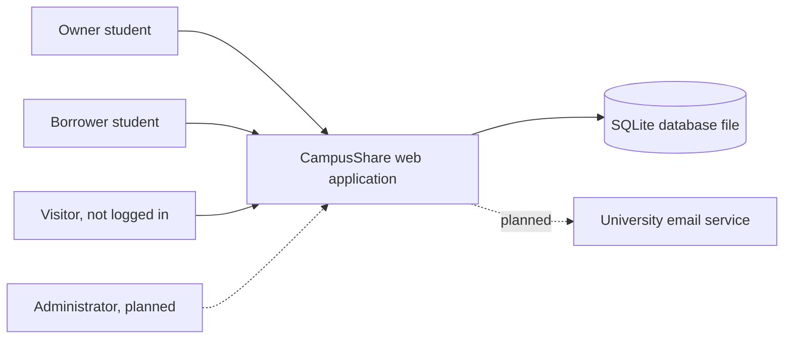
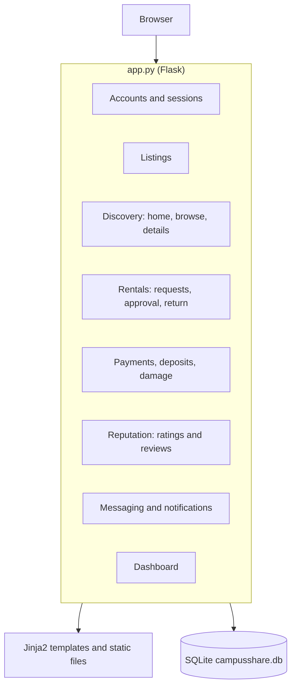
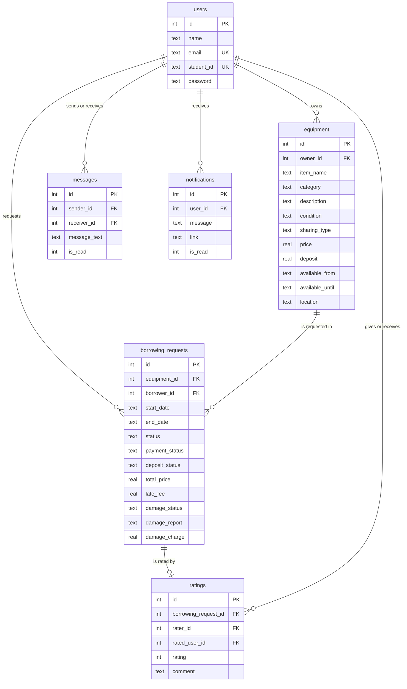
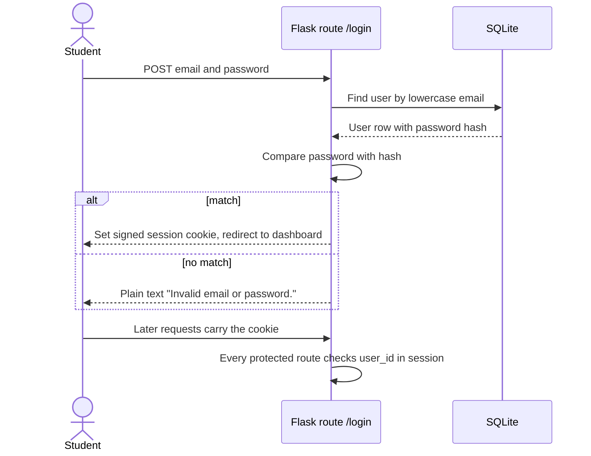
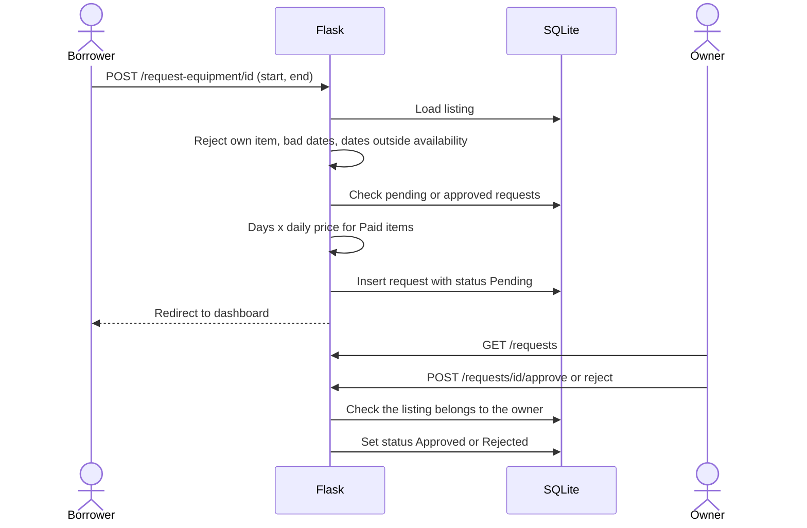
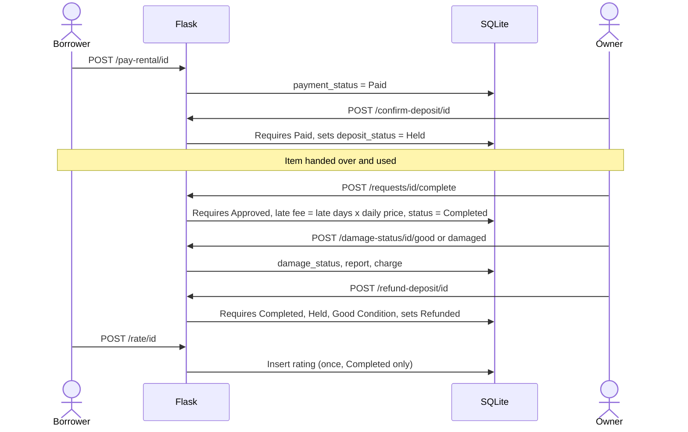
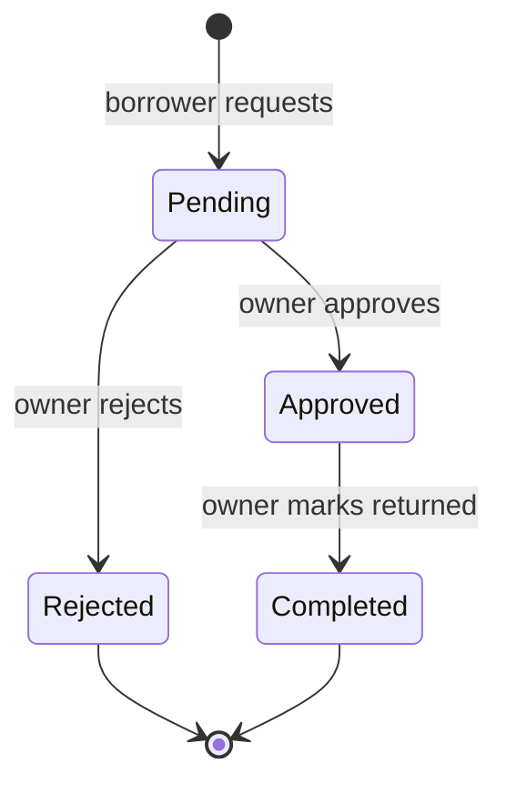
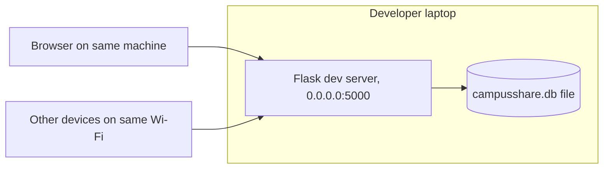
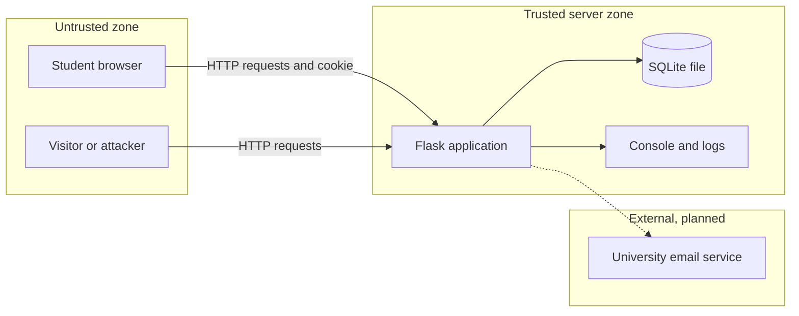
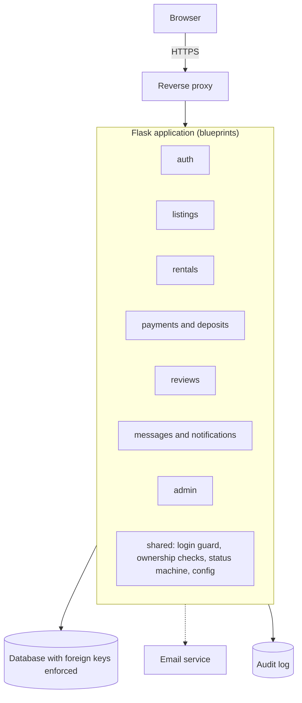

# CampusShare: Architecture and Design Description

| | |
|---|---|
| **Project** | CampusShare (Team 26F) |
| **Document** | Architecture and design description |
| **Version** | v0.1 (draft for team review) |
| **Date** | 2026-10-22 |
| **Author** | Sandra Masiwa (system design and documentation) |
| **Team** | Turay Edward Joe (backend and business logic), Amanda Nancy Skaikay (requirements analysis and usability review), Sandra Masiwa (system design and documentation) |
| **Standard followed** | ISO/IEC/IEEE 42010:2022 (architecture description), structure adapted for a course project |
| **Baseline** | `app.py` as reviewed on 2026-10-17 (repository commit `2403816`) |
| **Location** | `docs/design/design.md` |
| **Related documents** | [`SRS.md`](../requirements/SRS.md), [`user-roles-and-permissions.md`](../requirements/user-roles-and-permissions.md) |

> **Baseline note.** This document describes the application **as built at the baseline above**. Backend changes made by the team after that date are not yet reflected. Section 9 lists the places to update once they are pushed.

## Revision history

| Version | Date | Author | Change |
|---|---|---|---|
| v0.1 | 2026-10-22 | Sandra Masiwa | First draft from code review and manual testing |

## Table of contents

1. [Introduction](#1-introduction)
2. [Stakeholders and concerns](#2-stakeholders-and-concerns)
3. [Architecture overview](#3-architecture-overview)
4. [Architectural views](#4-architectural-views)
5. [Security and trust design](#5-security-and-trust-design)
6. [Design decisions and rationale](#6-design-decisions-and-rationale)
7. [Target architecture (proposed)](#7-target-architecture-proposed)
8. [Traceability to the SRS](#8-traceability-to-the-srs)
9. [Limitations and items to update](#9-limitations-and-items-to-update)
10. [Appendix A: Route inventory](#appendix-a-route-inventory)

---

## 1. Introduction

### 1.1 Purpose

This document describes the architecture and design of CampusShare, a web application for lending and borrowing equipment among Beihang University students. It explains how the system is organized, why it is organized that way, where its trust boundaries lie, and how the design should change to meet the requirements in the SRS.

### 1.2 Scope

It covers the application, its database, and its runtime environment. It does not cover the hand-over of physical items, which happens between students in person.

### 1.3 Reading guide

- Statements marked **(code)** come from reading `app.py`.
- Statements marked **(test)** come from manual testing of the running application.
- Statements marked **(proposed)** describe a design that does not yet exist.
- Requirement IDs such as `FR-REQ-08` and `SEC-05` refer to the [SRS](../requirements/SRS.md).

---

## 2. Stakeholders and concerns

| Stakeholder | Concerns |
|---|---|
| Owner students | Easy listing, safe handling of their items, fair damage and late-fee decisions, getting deposits right |
| Borrower students | Finding items quickly, clear prices and dates, protection from unfair charges, reminders |
| Administrator (planned) | Removing abusive listings or users, resolving disputes, seeing what happened |
| Development team | Code that is easy to change, test, and run on any laptop |
| Instructor and peer-review teams | Clear, consistent, verifiable documentation that matches the running system |
| Beihang University | Only genuine students use the service; student data is protected |

### 2.1 Viewpoints used

| Viewpoint | Concerns it answers | Section |
|---|---|---|
| Context | What is inside and outside the system | 4.1 |
| Logical (components) | How the code is organized | 4.2 |
| Data | What is stored and how it relates | 4.3 |
| Process | How the main workflows run | 4.4 |
| Deployment | Where and how it runs | 4.5 |
| Security and trust | Who must be trusted, what can go wrong | 5 |

---

## 3. Architecture overview

CampusShare is a **monolithic, server-rendered web application**:

- One Python file, `app.py`, holds the database setup and every route **(code)**.
- **Flask** receives browser requests, runs the logic, and returns HTML pages built from **Jinja2 templates** in `templates/`. Static files are in `static/`.
- **SQLite** stores all data in one file, `campusshare.db`, created on first start.
- **Sessions** are Flask's signed cookies. The cookie holds `user_id` and `user_name`.
- Each route opens its own database connection with `sqlite3`, runs raw SQL, and closes it **(code)**.

This keeps the system simple to run: install Flask, start `app.py`, open a browser. The cost is that logic, data access, and presentation choices are mixed in one file, which makes testing and security hardening harder (see sections 6 and 7).

---

## 4. Architectural views

### 4.1 Context view

External actors are students using browsers. The only external system planned is an email service for account verification and password reset (SRS FR-EXT-03).

### 4.2 Logical view: components as built

The code has no module boundaries, but the routes fall into clear groups:

| Component | Responsibility | Main routes |
|---|---|---|
| Accounts and sessions | Register, log in and out, reset password | `/register`, `/login`, `/logout`, `/forgot-password`, `/reset-password/<token>` |
| Listings | Create, edit, delete, and list own items | `/list-item`, `/edit-listing/<id>`, `/delete-listing/<id>`, `/my-listings` |
| Discovery | Home page, search, filters, item details | `/`, `/browse`, `/equipment/<id>` |
| Rentals | Request, approve, reject, return; list own rentals and incoming requests | `/request-equipment/<id>`, `/requests/<id>/approve`, `/reject`, `/complete`, `/my-rentals`, `/requests` |
| Payments, deposits, damage | Mark paid, hold and refund deposit, record damage | `/pay-rental/<id>`, `/confirm-deposit/<id>`, `/damage-status/<id>/<condition>`, `/refund-deposit/<id>` |
| Reputation | Rate owner, view reviews | `/rate/<id>`, `/my-reviews` |
| Messaging and notifications | Student list, chat, conversation list, notification list | `/students`, `/chat/<id>`, `/messages`, `/delete-message/<id>`, `/notifications` |
| Dashboard | Counts and average rating | `/dashboard` |

The full route list with access rules is in [Appendix A](#appendix-a-route-inventory).

**Observations on the structure (code):**
- Columns are read by position (for example `item[6]` for sharing type), so a change to the table layout can silently break pages.
- The same ownership-check pattern is repeated in many routes instead of shared.
- `init_db()` runs only when `app.py` is started directly.

### 4.3 Data view

**Design points:**
- The **password** column stores a salted hash made by Werkzeug **(code)**.
- Dates are stored as text in `YYYY-MM-DD` form. This sorts correctly but has no time of day, so part-day rentals are impossible (SRS FR-LST-08).
- A rental's whole life is tracked on **one row** of `borrowing_requests` using four status columns: `status`, `payment_status`, `deposit_status`, `damage_status`.
- `price` is a **daily** price. Total price is calculated once when the request is made.
- SQLite does not enforce foreign keys unless `PRAGMA foreign_keys = ON` is run on each connection. The code never runs it, so records can be orphaned **(code)**. Deleting a listing removes its requests, but ratings that point to those requests remain.
- Equipment status (Available, Pending, Booked) is **not stored**. It is worked out from requests each time a page loads **(code)**.

### 4.4 Process view

#### 4.4.1 Login and session

Each protected route repeats the check `if "user_id" not in session`. There is no central login guard, no idle timeout, and no failed-attempt limit.

#### 4.4.2 Request and approval

No notification is created for the owner or the borrower at either step (SRS FR-NTF-01). The approve and reject routes do not check the current status (SRS FR-REQ-08).

#### 4.4.3 Return, damage, and deposit

All money fields are labels and numbers. No payment provider is involved. If an item is returned **Damaged**, no route applies the charge to the deposit, so that path has no end state (SRS FR-PAY-07). During testing the damage button failed. In the code, the final database update appears to receive its values in the wrong form (**to verify**), which would also block every refund because refunds need Good Condition.

#### 4.4.4 Request status machine

This is the **intended** machine. The code allows other changes, such as approving a rejected request, because the current status is not checked.

### 4.5 Deployment view

**As built:**

- The server listens on **all network addresses**, so other devices on the same network can reach it **(code, test)**.
- `debug` is off, which is correct.
- The Flask development server is used. Flask's own warning says it is not for production.
- There is no `requirements.txt`. A newcomer must guess to install Flask.
- Traffic is plain HTTP.

**Proposed for the demonstration and launch:** see section 7.

---

## 5. Security and trust design

### 5.1 Assets

| Asset | Why it matters |
|---|---|
| Account credentials and sessions | Control of an account means control of its listings, rentals, and messages |
| Personal data: name, email, student ID | Privacy; identity of real students |
| Listings and rental records | Basis of loans, deposits, and disputes |
| Deposit, payment, and damage records | Money-related decisions; fairness between students |
| Messages | Private conversations |
| Secret key | Signs cookies and password-reset tokens |

### 5.2 Trust boundaries

Everything that arrives from a browser, including form fields, URL parameters, and cookies, must be treated as untrusted. The server is the only place where rules can be enforced. A rule that exists only in the page (a disabled button, a date picker) is not a security control.

### 5.3 Threat analysis (STRIDE)

| Threat | Scenario | Present weakness | Evidence | Planned control |
|---|---|---|---|---|
| **Spoofing** | Anyone registers with a made-up `@buaa.edu.cn` email and student ID | Only the email ending is checked | code, test | SEC-01 email confirmation; open issue on student ID source |
| **Spoofing** | Attacker forges a session cookie or reset link | Secret key is written in the source file | code | SEC-04 secret from environment |
| **Spoofing** | Password guessing | No password rules, no attempt limit | code | SEC-02, SEC-07 |
| **Tampering** | A malicious page makes a logged-in user's browser submit an action | No CSRF tokens on forms | code | SEC-05 |
| **Tampering** | Calling routes directly in the wrong order (pay a pending request, approve a rejected one) | Status is not checked | code | FR-REQ-08 central status machine |
| **Tampering** | Borrower marks own rental "Paid" without paying | Paid is a label the borrower sets | code | FR-PAY-10 or owner confirmation of payment |
| **Repudiation** | An owner denies approving or charging; a borrower denies paying | No log of actions | code | SEC-16 audit log |
| **Information disclosure** | Any user reads every student's name and email | `/students` lists them | code | SEC-13 show names only |
| **Information disclosure** | Reset link printed to the console and logs | `print` of the link | code | SEC-14, email delivery |
| **Information disclosure** | Visitor learns which emails are registered | Reset form crashes for unregistered emails only | code | SEC-11 identical response |
| **Information disclosure** | Listings and owner names visible without login | Browse and details are public | code | Team decision (SRS section 6, question 1) |
| **Denial of service** | Many requests or large messages slow the server; SQLite locks on writes | No rate limits; one file database | code | SEC-07, NFR-PERF-01, move to a server database if load grows |
| **Elevation of privilege** | A user acts on another user's listing or rental | Ownership is checked on most routes | code | SEC-08 keep and centralize; add tests TC-10 |
| **Elevation of privilege** | No one can stop an abusive user | No administrator role | code | FR-ADM-01 to 03 |

**What already works well (code):** passwords are hashed with salt; database queries use parameters, which prevents SQL injection; ownership checks exist on edit, delete, approve, reject, return, deposit, damage, and refund; messages can be deleted only by their sender; debug mode is off.

### 5.4 Trust design: how students come to trust each other

A sharing platform works only if students trust three things: **who** they are dealing with, **what happens if something goes wrong**, and **who decides**. The design addresses each.

| Trust question | Current design | Gap | Proposed design |
|---|---|---|---|
| Is this person a real Beihang student? | Email suffix check | Anyone can pass it | Email confirmation link; later, a check of the student ID against an approved source (decision needed) |
| Can I rely on this person? | Borrowers rate owners (1 to 5, comment) | Owners cannot rate borrowers; ratings do not affect anything | Two-way ratings; show average and count on the listing page |
| What if the item comes back damaged? | Owner alone records damage and a charge | Borrower cannot respond; charge is never applied to the deposit | Borrower can view and dispute; deposit is held against the charge until resolved |
| What if the item is late? | Late fee = days late x daily price at return | Free items have zero fee; no reminders or overdue state | Overdue status, reminders, and a rule for free items (decision needed) |
| Who settles a dispute or removes a bad actor? | Nobody | No administrator | Administrator role with removal, suspension, and dispute review |
| Is my private information safe? | Passwords hashed | Directory exposes emails; reset link in console | Show names only; email the reset link; minimize stored data |
| Can I contact someone safely? | Direct messages with a 1,000 character limit | No block or report | Report-and-block option (could-have) |

### 5.5 Security controls summary

| Control | Status | SRS |
|---|---|---|
| Password hashing | In place | SEC-03 |
| Parameterized SQL | In place | SEC-10 |
| Ownership checks | Mostly in place | SEC-08 |
| Secret key from configuration | Missing | SEC-04 |
| CSRF protection | Missing | SEC-05 |
| Session timeout and cookie flags | Missing | SEC-06 |
| Login attempt limit | Missing | SEC-07 |
| Password rules | Missing | SEC-02 |
| Email confirmation | Missing | SEC-01 |
| Local-only dev server, HTTPS in deployment | Missing | SEC-12 |
| Audit log | Missing | SEC-16 |

---

## 6. Design decisions and rationale

### 6.1 Decisions as built

| ID | Decision | Rationale | Consequence |
|---|---|---|---|
| D-01 | One Flask application in a single file, server-rendered pages | Fast to build and run; no separate frontend to maintain | Hard to test and review; logic and presentation are mixed |
| D-02 | SQLite file database | No installation; suits a small prototype | Single writer; no enforced foreign keys by default; hard to scale |
| D-03 | One account type, with roles decided by ownership of a listing or rental | A student is often both lender and borrower | Simple, but no place for an administrator role |
| D-04 | Signed cookie sessions | Built into Flask | Security rests on the secret key, which is currently in the source |
| D-05 | Rental state kept as four text columns on one row | One table covers the full life of a rental | Valid state combinations are enforced only by scattered `if` checks |
| D-06 | Price is per day; total calculated at request time | Simple and predictable | No hourly rental; later price changes do not alter the stored total |
| D-07 | Payment, deposit, and damage as status labels | A real payment gateway is out of scope for the course | Nothing prevents false "Paid" claims |
| D-08 | Registration limited by email suffix | Cheap way to keep the platform for Beihang students | Not real verification |
| D-09 | Equipment status derived from requests, not stored | Avoids two values going out of step | Extra queries on every browse and detail page |

### 6.2 Decisions proposed

| ID | Proposed decision | Addresses |
|---|---|---|
| P-01 | Split the app into Flask **blueprints** by component (section 4.2) and move SQL into a small data-access module | NFR-MNT-02, testability |
| P-02 | Read secret key and settings from **environment variables** | SEC-04 |
| P-03 | Create one **status-change function** that allows only the transitions in section 4.4.4 | FR-REQ-08 |
| P-04 | Add **CSRF protection** to all forms (for example Flask-WTF) | SEC-05 |
| P-05 | Add **rate limiting** on login and reset (for example Flask-Limiter) | SEC-07 |
| P-06 | Send **email confirmation and reset links** using the existing token tool (`itsdangerous`) and a mail service | SEC-01, FR-AUTH-06 |
| P-07 | Turn on `PRAGMA foreign_keys = ON` and prevent deletion of listings with approved or completed rentals | NFR-REL-01, FR-LST-05 |
| P-08 | Use a **login guard** (one decorator) and one place for ownership checks | SEC-08 |
| P-09 | Add a `role` column to `users` with value `student` or `admin` | FR-ADM-01 |
| P-10 | Store date **and time** for availability and rentals | FR-LST-08 |
| P-11 | Add an `audit_log` table | SEC-16 |
| P-12 | Bind to `127.0.0.1` in development; serve over HTTPS behind a reverse proxy for any shared use | SEC-12 |

*These are proposals for the team to accept or reject. Section 6 of the SRS lists the scope questions that decide which ones are built before Week 16.*

---

## 7. Target architecture (proposed)

| Layer | Change from today |
|---|---|
| Presentation | Same Jinja2 templates; add form-level error messages and date pickers that block past dates |
| Application | Blueprints per component; shared guard, checks, and status machine |
| Data | Same SQLite for the course demo, with foreign keys on and a `role` column and audit table added; a server database is the step after that |
| Operations | `requirements.txt`, environment settings, local-only development binding, HTTPS for any shared deployment, daily database backup |

The target keeps the technology the team already knows. The main changes are structure and security, not a rewrite.

---

## 8. Traceability to the SRS

| Design element | Realizes or affects |
|---|---|
| 4.2 Accounts and sessions | FR-AUTH-01 to 06, SEC-01 to 07 |
| 4.2 Listings | FR-LST-01 to 08 |
| 4.2 Discovery | FR-BRW-01 to 04 |
| 4.2 Rentals and 4.4.2, 4.4.4 | FR-REQ-01 to 10 |
| 4.2 Payments and 4.4.3 | FR-PAY-01 to 10 |
| 4.2 Reputation | FR-RAT-01 to 04 |
| 4.2 Messaging and notifications | FR-MSG-01 to 04, FR-NTF-01 to 05 |
| 4.3 Data view | Section 3.5 of the SRS, NFR-REL-01 |
| 4.5 Deployment and 7 | SEC-12, NFR-MNT-01, NFR-POR-01, NFR-REL-02 |
| 5.3 and 5.4 Security and trust | SEC-01 to 16, FR-ADM-01 to 03, FR-PAY-07, FR-PAY-08 |
| P-01 to P-12 | See the right-hand column of section 6.2 |

---

## 9. Limitations and items to update

1. **Baseline.** The description matches `app.py` at repository commit `2403816`. Backend changes made by Turay Edward Joe after that date must be added. Likely places: the payment, deposit, late-fee, and damage sequence (4.4.3), the data view (4.3), the route inventory (Appendix A), and the controls table (5.5).
2. **To verify by testing:** the cause of the failed damage button; whether the unexpected logouts were caused by using two accounts in one browser; whether templates escape user text everywhere (SEC-15).
3. **Decisions pending** from SRS section 6: public browsing, real payments, student ID verification, free-item late fees, hourly rental, administrator role, and scope for Week 16.
4. **Not covered yet:** a detailed design of each template, performance measurements, and the test plan, which will go in `docs/testing/`.

---

## Appendix A: Route inventory

Access as built **(code)**. "Login" means the route redirects visitors to the login page.

| Route | Methods | Login | Who may act | Purpose |
|---|---|---|---|---|
| `/` | GET | No | Anyone | Home page |
| `/register` | GET, POST | No | Visitor | Create account (`@buaa.edu.cn` only) |
| `/login` | GET, POST | No | Visitor | Log in |
| `/logout` | GET | No | Anyone | End session |
| `/forgot-password` | GET, POST | No | Visitor | Start password reset (link printed to console) |
| `/reset-password/<token>` | GET, POST | No | Holder of valid token | Set a new password (30 minute limit) |
| `/dashboard` | GET | Yes | Registered user | Counts and average rating |
| `/browse` | GET | No | Anyone | Search and filter listings |
| `/equipment/<id>` | GET | No | Anyone | Item details and status |
| `/list-item` | GET, POST | Yes | Registered user | Create listing |
| `/my-listings` | GET | Yes | Registered user | Own listings with status |
| `/edit-listing/<id>` | GET, POST | Yes | Listing owner | Edit listing |
| `/delete-listing/<id>` | POST | Yes | Listing owner | Delete listing and its requests |
| `/request-equipment/<id>` | POST | Yes | Registered user, not the owner | Request an item |
| `/requests` | GET | Yes | Owner | Requests on own listings |
| `/requests/<id>/approve` | POST | Yes | Listing owner | Approve |
| `/requests/<id>/reject` | POST | Yes | Listing owner | Reject |
| `/requests/<id>/complete` | POST | Yes | Listing owner | Mark returned, calculate late fee |
| `/my-rentals` | GET | Yes | Borrower | Own rentals |
| `/pay-rental/<id>` | POST | Yes | Borrower | Mark as Paid |
| `/confirm-deposit/<id>` | POST | Yes | Listing owner | Mark deposit Held (after Paid) |
| `/damage-status/<id>/<condition>` | POST | Yes | Listing owner | Record Good or Damaged, report, charge |
| `/refund-deposit/<id>` | POST | Yes | Listing owner | Mark deposit Refunded (after Good Condition) |
| `/rate/<id>` | GET, POST | Yes | Borrower of a Completed rental | Rate the owner, once |
| `/my-reviews` | GET | Yes | Registered user | Reviews received |
| `/students` | GET | Yes | Registered user | List of all other users (name, email) |
| `/chat/<student_id>` | GET, POST | Yes | Registered user | Conversation; sends message and creates notification |
| `/messages` | GET | Yes | Registered user | Conversation list with unread counts |
| `/delete-message/<id>` | POST | Yes | Message sender | Delete own message |
| `/notifications` | GET | Yes | Registered user | Notification list |
