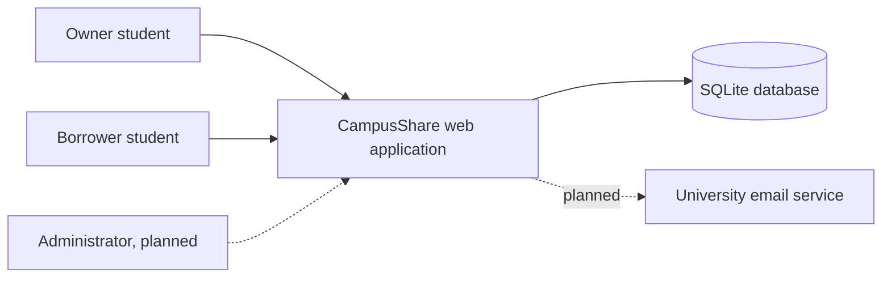
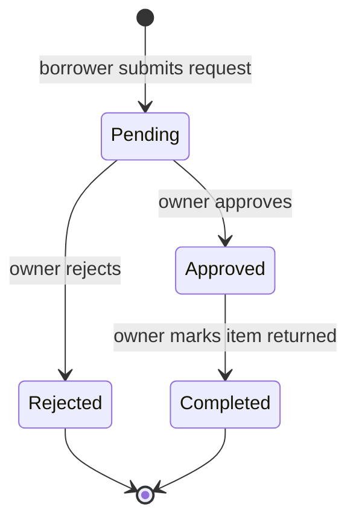
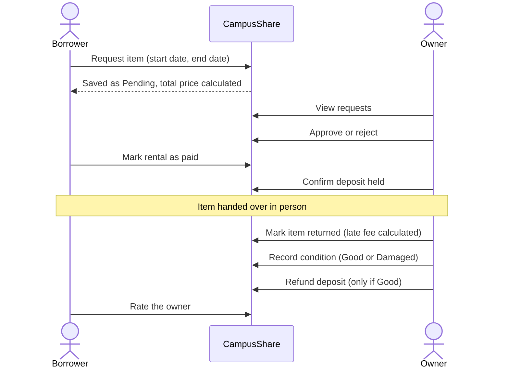
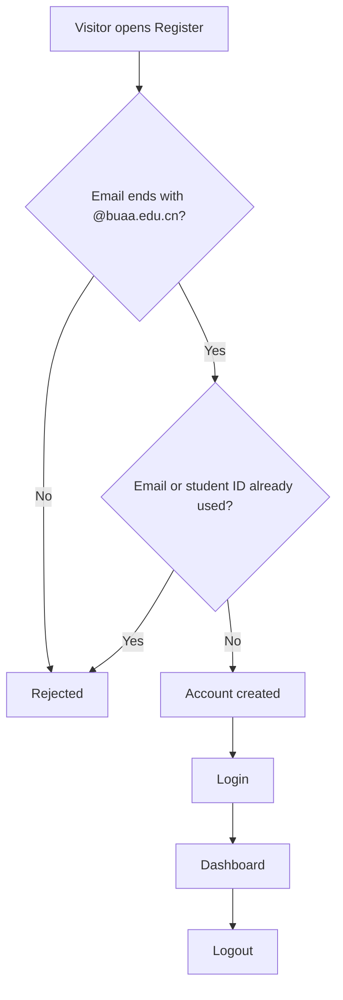

# CampusShare: Software Requirements Specification (SRS)

| | |
|---|---|
| **Project** | CampusShare (Team 26F) |
| **Document** | Software Requirements Specification |
| **Version** | v0.1 (draft for team review) |
| **Date** | 2026-10-18 |
| **Author** | Sandra Masiwa (systems design and documentation) |
| **Team** | Turay Edward Joe (backend and business logic), Amanda Nancy Skaikay (requirements analysis and usability review), Sandra Masiwa (system design and documentation) |
| **Standard followed** | ISO/IEC/IEEE 29148:2018 (structure adapted for a course project) |
| **Location** | `docs/requirements/SRS.md` |

## Revision history

| Version | Date | Author | Change |
|---|---|---|---|
| v0.1 | 2026-10-18 | Sandra Masiwa | First draft, based on review of `app.py` and manual testing |

## Table of contents

1. [Introduction](#1-introduction)
2. [Overall description](#2-overall-description)
3. [Specific requirements](#3-specific-requirements)
4. [Process flows](#4-process-flows)
5. [Verification and traceability](#5-verification-and-traceability)
6. [Open issues for team decision](#6-open-issues-for-team-decision)
7. [Appendix A: Current-state gaps](#appendix-a-current-state-gaps)

---

## 1. Introduction

### 1.1 Purpose

This document specifies the requirements of CampusShare, a web application that lets Beihang University students lend and borrow equipment. It is written for the development team, the instructor, and the peer-review teams. It describes what the system must do, which requirements the current prototype already meets, and which it does not.

### 1.2 Scope

**CampusShare** lets a student list equipment they own, lets other students browse and request it, and supports the whole loan: approval, payment status, deposit handling, return, damage assessment, ratings, and messaging.

**In scope:** account management, equipment listings, search, borrowing requests, payment and deposit tracking, returns, damage reports, ratings, messaging, notifications, and basic administration.

**Out of scope (unless the team decides otherwise, see section 6):** real online payment processing, delivery or logistics, and users outside Beihang University.

### 1.3 Definitions

| Term | Meaning |
|---|---|
| Owner (lender) | A registered user who has listed an item |
| Borrower | A registered user who has requested an item |
| Listing | An equipment record created by an owner |
| Request / rental | A borrowing request, which becomes a rental once approved |
| Deposit | An amount set by the owner and held against damage or loss |
| Late fee | A charge for returning an item after the agreed end date |
| SRS | Software Requirements Specification |

### 1.4 References

1. ISO/IEC/IEEE 29148:2018, *Systems and software engineering: Life cycle processes: Requirements engineering*
2. ISO/IEC/IEEE 42010:2022, *Architecture description* (used for the Week 11 design document)
3. Software Engineering GitHub Operations Guide (course)
4. `docs/requirements/user-roles-and-permissions.md` (roles and permissions detail)
5. Source code: `app.py`, `templates/`, `static/`

### 1.5 Conventions

- Requirements use the word **shall**. Each has a unique ID.
- **ID format:** `FR-<area>-<nn>` for functional, `SEC-<nn>` for security, `NFR-<area>-<nn>` for non-functional.
- **Priority** (MoSCoW): **M** = Must, **S** = Should, **C** = Could.
- **Status** of the current prototype: **Done** = implemented as specified, **Partial** = implemented in part or with known defects, **Missing** = not implemented.
- **Verification:** **T** = test, **D** = demonstration, **I** = inspection of code or documents.
- Evidence tags in the appendix: **code** = from reading `app.py`, **test** = from manual testing.

### 1.6 Overview

Section 2 describes the product and its users. Section 3 lists the requirements. Section 4 shows the main process flows. Section 5 explains how requirements will be verified. Section 6 lists decisions the team must make. The appendix records the gaps found in the current prototype.

---

## 2. Overall description

### 2.1 Product perspective

CampusShare is a standalone web application. Users access it through a browser. The server stores all data in a single SQLite database file.

### 2.2 Product functions (summary)

1. Register, log in, log out, and reset a password
2. Create, edit, and delete equipment listings
3. Browse, search, and filter listings
4. Request equipment for a date range, with price calculation
5. Approve or reject requests (owner)
6. Record payment, deposit, return, late fees, and damage (owner and borrower)
7. Rate owners after completed rentals
8. Message other students and receive notifications

### 2.3 User classes

CampusShare has one account type. Roles depend on the situation. Full detail is in `user-roles-and-permissions.md`.

| Role | Description |
|---|---|
| Visitor | Not logged in. Can view public pages and register or log in |
| Registered user | Logged-in student. Can list items, request items, message, and review |
| Owner | Registered user who owns a given listing. Can approve, reject, complete rentals, and handle deposits and damage for that listing |
| Borrower | Registered user who made a given request. Can pay and rate |
| Administrator | **Not implemented.** Proposed in FR-ADM-01 |

### 2.4 Operating environment

- Python 3 with Flask, Werkzeug, and itsdangerous (tested on macOS with Python 3.14)
- SQLite database file `campusshare.db`, created on first run
- Modern desktop and mobile web browsers
- Current prototype runs on the Flask development server, port 5000

### 2.5 Constraints

- Registration is limited to Beihang University email addresses (`@buaa.edu.cn`).
- The project is developed by a student team within one semester. Deadlines: SRS in Week 7, design in Week 11, product launch in Week 16.
- No real payment gateway is available to the team (assumption, see section 6).

### 2.6 Assumptions and dependencies

- Users meet in person to hand over and return items. The system records the loan but does not move the item.
- Users have access to their university email, which a verification feature would depend on.
- The owner's judgement is trusted for damage assessment until a dispute process exists.

---

## 3. Specific requirements

### 3.1 External interfaces

| ID | Requirement | Pri | Status | Ver |
|---|---|---|---|---|
| FR-EXT-01 | The system shall provide a browser-based user interface for all functions. | M | Done | D |
| FR-EXT-02 | The system shall store all persistent data in a relational database. | M | Done | I |
| FR-EXT-03 | The system shall send email to users for account verification and password reset. | M | Missing | T |

### 3.2 Functional requirements

#### 3.2.1 Accounts and authentication

| ID | Requirement | Pri | Status | Ver |
|---|---|---|---|---|
| FR-AUTH-01 | The system shall let a visitor register by providing name, university email, student ID, password, and password confirmation. | M | Done | T |
| FR-AUTH-02 | The system shall accept registration only for email addresses ending in `@buaa.edu.cn`. | M | Done | T |
| FR-AUTH-03 | The system shall reject registration if the email or student ID is already registered. | M | Done | T |
| FR-AUTH-04 | The system shall let a registered user log in with email and password, ignoring letter case in the email. | M | Done | T |
| FR-AUTH-05 | The system shall end the user's session on logout. | M | Done | T |
| FR-AUTH-06 | The system shall let a user reset a forgotten password using a link sent to the registered email, valid for 30 minutes and usable once. | M | Partial | T |

*FR-AUTH-06 status:* the 30-minute expiry exists, but the link is printed to the server console instead of emailed, and it can be reused within the time limit.

#### 3.2.2 Equipment listings

| ID | Requirement | Pri | Status | Ver |
|---|---|---|---|---|
| FR-LST-01 | The system shall let a registered user create a listing with name, category, description, condition, sharing type (Free or Paid), daily price, deposit, availability start and end dates, and location. | M | Done | T |
| FR-LST-02 | The system shall reject a listing whose availability end date is before its start date. | M | Done | T |
| FR-LST-03 | The system shall reject a listing whose availability start date is in the past. | M | Missing | T |
| FR-LST-04 | The system shall let an owner edit their own listings. | M | Done | T |
| FR-LST-05 | The system shall let an owner delete a listing only when it has no approved or completed rentals. | M | Missing | T |
| FR-LST-06 | The system shall show each listing's status as Available, Pending, or Booked. | M | Done | T |
| FR-LST-07 | The system shall let an owner upload at least one image per listing (JPG or PNG, at most 5 MB). | S | Missing | T |
| FR-LST-08 | The system shall let an owner specify pickup and return times so that items can be borrowed for part of a day. | S | Missing | T |

*FR-LST-05 note:* the current code deletes a listing together with all its requests, including approved ones.

#### 3.2.3 Browse and search

| ID | Requirement | Pri | Status | Ver |
|---|---|---|---|---|
| FR-BRW-01 | The system shall list equipment, newest first. | M | Done | T |
| FR-BRW-02 | The system shall search listings by keyword in name, category, and description. | M | Done | T |
| FR-BRW-03 | The system shall filter listings by category and by status. | M | Done | T |
| FR-BRW-04 | The system shall show a detail page with description, condition, price, deposit, availability, location, owner name, and status. | M | Done | T |

#### 3.2.4 Borrowing requests

| ID | Requirement | Pri | Status | Ver |
|---|---|---|---|---|
| FR-REQ-01 | The system shall let a logged-in user request a listing for a start and end date. | M | Done | T |
| FR-REQ-02 | The system shall reject a request on the user's own listing. | M | Done | T |
| FR-REQ-03 | The system shall reject a request whose dates fall outside the listing's availability period or whose end date is before its start date. | M | Done | T |
| FR-REQ-04 | The system shall reject a request when the listing already has a pending or approved request. | M | Done | T |
| FR-REQ-05 | The system shall calculate the total price as the number of days (inclusive) multiplied by the daily price for Paid listings, and zero for Free listings. | M | Done | T |
| FR-REQ-06 | The system shall show the borrower a running cost estimate while they choose dates, before they submit. | S | Missing | D |
| FR-REQ-07 | The system shall let an owner approve or reject a request only while it is Pending. | M | Partial | T |
| FR-REQ-08 | The system shall allow only these status changes: Pending to Approved, Pending to Rejected, Approved to Completed. | M | Missing | T |
| FR-REQ-09 | The system shall allow several non-overlapping bookings of one listing. | S | Missing | T |
| FR-REQ-10 | The system shall show a borrower the time remaining on an approved rental. | C | Missing | D |

*FR-REQ-07 note:* ownership is checked, but the current status is not.

#### 3.2.5 Payment, return, deposit, and damage

| ID | Requirement | Pri | Status | Ver |
|---|---|---|---|---|
| FR-PAY-01 | The system shall record the payment status (Unpaid or Paid) of each request. | M | Done | T |
| FR-PAY-02 | The system shall let the owner mark the deposit as Held only after payment is recorded as Paid. | M | Done | T |
| FR-PAY-03 | The system shall let the owner mark an approved rental as returned (Completed). | M | Done | T |
| FR-PAY-04 | The system shall calculate a late fee at return as the number of days after the agreed end date multiplied by the daily price. | M | Done | T |
| FR-PAY-05 | The system shall let the owner record the item's condition on return as Good Condition, or as Damaged with a description and a non-negative charge. | M | Partial | T |
| FR-PAY-06 | The system shall let the owner refund the deposit only when the rental is Completed, the deposit is Held, and the condition is Good Condition. | M | Done | T |
| FR-PAY-07 | The system shall apply a damage charge against the held deposit when an item is returned damaged. | S | Missing | T |
| FR-PAY-08 | The system shall let the borrower view a damage report and dispute it before the charge is final. | S | Missing | D |
| FR-PAY-09 | The system shall mark a rental as Overdue when the end date has passed without a return. | S | Missing | T |
| FR-PAY-10 | The system shall support online payment through an external provider. | C | Missing | D |

*FR-PAY-05 note:* in testing the damage button did not work. The code that saves the damage record appears to pass its values to the database incorrectly (**to verify**). Until fixed, no deposit can be refunded because FR-PAY-06 requires Good Condition.

*FR-PAY-01 note:* Paid is only a label that the borrower sets. No money moves.

#### 3.2.6 Ratings and reviews

| ID | Requirement | Pri | Status | Ver |
|---|---|---|---|---|
| FR-RAT-01 | The system shall let a borrower rate the owner from 1 to 5 stars with a comment, once per completed rental. | M | Done | T |
| FR-RAT-02 | The system shall let a user view the reviews they have received. | M | Done | T |
| FR-RAT-03 | The system shall show each user's average rating on their dashboard. | S | Done | T |
| FR-RAT-04 | The system shall let an owner rate the borrower. | C | Missing | T |

#### 3.2.7 Messaging

| ID | Requirement | Pri | Status | Ver |
|---|---|---|---|---|
| FR-MSG-01 | The system shall let a registered user send a text message of up to 1,000 characters to another registered user. | M | Done | T |
| FR-MSG-02 | The system shall show a list of conversations with the latest message and unread count. | M | Done | T |
| FR-MSG-03 | The system shall mark messages as read when the recipient opens the conversation. | M | Done | T |
| FR-MSG-04 | The system shall let a user delete only messages they sent. | S | Done | T |

#### 3.2.8 Notifications and reminders

| ID | Requirement | Pri | Status | Ver |
|---|---|---|---|---|
| FR-NTF-01 | The system shall create a notification for the relevant user when a new request is received, approved, or rejected, and when a rental is returned, paid, or assessed for damage. | M | Missing | T |
| FR-NTF-02 | The system shall create a notification when a user receives a new message. | M | Done | T |
| FR-NTF-03 | The system shall let a user mark notifications as read. | M | Missing | T |
| FR-NTF-04 | The system shall remind a borrower 24 hours before the end date and when a rental becomes overdue. | S | Missing | T |
| FR-NTF-05 | The system shall offer email delivery of notifications. | C | Missing | D |

*FR-NTF-02 note:* this is the only event that currently creates a notification, which is why testers saw none for requests.

#### 3.2.9 Administration

| ID | Requirement | Pri | Status | Ver |
|---|---|---|---|---|
| FR-ADM-01 | The system shall provide an Administrator role. | S | Missing | I |
| FR-ADM-02 | The system shall let an administrator remove listings and suspend accounts. | S | Missing | D |
| FR-ADM-03 | The system shall let an administrator review and resolve disputes about damage charges. | C | Missing | D |

### 3.3 Security requirements

| ID | Requirement | Pri | Status | Ver |
|---|---|---|---|---|
| SEC-01 | The system shall activate an account only after the user confirms a link sent to the registered university email. | M | Missing | T |
| SEC-02 | The system shall require passwords of at least 8 characters that are not on a list of common passwords. | M | Missing | T |
| SEC-03 | The system shall store passwords only as salted hashes. | M | Done | I |
| SEC-04 | The system shall read its secret key from configuration outside the source code. | M | Missing | I |
| SEC-05 | The system shall protect every state-changing request against cross-site request forgery. | M | Missing | T |
| SEC-06 | The system shall end sessions after 30 minutes of inactivity and shall set the cookie flags HttpOnly and SameSite, and Secure when served over HTTPS. | M | Missing | T |
| SEC-07 | The system shall block further login attempts for 15 minutes after 5 failed attempts for the same account. | M | Missing | T |
| SEC-08 | The system shall check on the server that the acting user owns the listing or request before any owner-only or borrower-only action. | M | Partial | T |
| SEC-09 | The system shall validate all input on the server (types, ranges, dates, lengths) and respond with a clear error page instead of failing. | M | Partial | T |
| SEC-10 | The system shall use parameterized database queries for all data access. | M | Done | I |
| SEC-11 | The system shall make password-reset links single-use and shall not reveal whether an email is registered. | M | Partial | T |
| SEC-12 | The system shall bind the development server to the local machine only and shall be served over HTTPS in deployment. | M | Missing | I |
| SEC-13 | The system shall show other users only a name, not an email address or student ID. | M | Missing | T |
| SEC-14 | The system shall not write secrets, tokens, or reset links to logs or consoles. | M | Missing | I |
| SEC-15 | The system shall escape user-supplied text on every page to prevent script injection. | M | To verify | I |
| SEC-16 | The system shall log security-relevant events: failed logins, approvals, deposit changes, and damage decisions. | S | Missing | I |

*SEC-08 status:* ownership checks exist on edit, delete, approve, reject, return, deposit, damage, and refund. State checks are missing (see FR-REQ-08).

### 3.4 Non-functional requirements

| ID | Requirement | Pri | Status | Ver |
|---|---|---|---|---|
| NFR-PERF-01 | The system shall return browse and search results within 2 seconds for 95% of requests with 1,000 listings and 50 simultaneous users. *(proposed target, to confirm)* | S | Not measured | T |
| NFR-USE-01 | The system shall show validation messages beside the form fields and shall prevent selecting past dates in date pickers. | S | Missing | D |
| NFR-USE-02 | The system shall show consistently styled error pages instead of plain text messages. | S | Missing | D |
| NFR-USE-03 | The system shall be usable on screens from 360 px wide. | S | To verify | D |
| NFR-REL-01 | The system shall enforce database referential integrity so that no record refers to a deleted record. | M | Missing | I |
| NFR-REL-02 | The system shall back up the database at least once a day. | S | Missing | I |
| NFR-MNT-01 | The project shall provide a `requirements.txt` listing all dependencies. | M | Missing | I |
| NFR-MNT-02 | The project shall split the application into modules (routes, database access, templates) and include automated tests for the request lifecycle and access control. | S | Missing | I |
| NFR-POR-01 | The system shall run on macOS, Windows, and Linux with Python 3. | S | Done (macOS) | D |

*NFR-REL-01 note:* SQLite does not enforce foreign keys unless `PRAGMA foreign_keys = ON` is set for each connection, and the code does not set it.

### 3.5 Data requirements

| Entity | Key attributes |
|---|---|
| users | id, name, email (unique), student_id (unique), password hash |
| equipment | id, owner, name, category, description, condition, sharing type, price, deposit, availability dates, location |
| borrowing_requests | id, equipment, borrower, start and end date, status, payment status, deposit status, total price, late fee, damage status, damage report, damage charge |
| ratings | id, request (unique), rater, rated user, rating (1 to 5), comment |
| messages | id, sender, receiver, text, time, read flag |
| notifications | id, user, message, link, read flag, time |

Allowed values: **status** is Pending, Approved, Rejected, or Completed. **Payment status** is Unpaid or Paid. **Deposit status** is Pending, Held, or Refunded. **Damage status** is Not Checked, Good Condition, or Damaged.

---

## 4. Process flows

### 4.1 Request lifecycle

The current code does not stop other changes, such as approving a rejected request (FR-REQ-08).

### 4.2 Main borrowing flow

### 4.3 Account flow

*Planned change:* between account creation and login, the user confirms an email link (SEC-01).

---

## 5. Verification and traceability

Each requirement has a verification method (column **Ver**). The detailed test plan will go in `docs/testing/`. Examples of acceptance tests:

| Test | Requirement | Expected result |
|---|---|---|
| TC-01 Register with a Gmail address | FR-AUTH-02 | Registration refused |
| TC-02 Register twice with the same student ID | FR-AUTH-03 | Second attempt refused |
| TC-03 List an item with an end date before the start date | FR-LST-02 | Listing refused |
| TC-04 List an item starting yesterday | FR-LST-03 | Listing refused |
| TC-05 Request your own item | FR-REQ-02 | Request refused |
| TC-06 Request a 3-day rental of a Paid item at 10 per day | FR-REQ-05 | Total price is 30 |
| TC-07 Try to approve a rejected request | FR-REQ-08 | Action refused |
| TC-08 Return an item 2 days late at 10 per day | FR-PAY-04 | Late fee is 20 |
| TC-09 Mark an item Damaged without a description | FR-PAY-05 | Refused with a message |
| TC-10 Open another user's edit page by its address | SEC-08 | Access refused |
| TC-11 Submit a form from another website while logged in | SEC-05 | Request refused |
| TC-12 Six wrong passwords in a row | SEC-07 | Account locked for 15 minutes |
| TC-13 Send a message with a script tag | SEC-15 | Shown as text, not run |

---

## 6. Open issues for team decision

| # | Question | Why it matters |
|---|---|---|
| 1 | Should browsing and item details be public, or visible only after login? | Listings currently expose owner names and locations to anyone |
| 2 | Is real payment in scope, or only status tracking? | Decides FR-PAY-10 and the deposit design |
| 3 | How is a student ID verified, and against what source? | Email confirmation proves the email, not the student ID |
| 4 | Do Free items carry a late fee or deposit penalty? | Late fee currently equals days multiplied by price, which is zero for free items |
| 5 | Is hourly borrowing in scope? | Needs time fields in listings and requests (FR-LST-08) |
| 6 | Is an Administrator role in scope for this semester? | Needed for disputes and abuse handling |
| 7 | Which Should and Could requirements will be built before Week 16? | Fixes the scope for the design and the demonstration |

---

## Appendix A: Current-state gaps

Found by reading `app.py` and by manual testing on 2026-10-17 and 2026-10-18.

| ID | Observation | Evidence | Requirement |
|---|---|---|---|
| G-01 | A made-up `@buaa.edu.cn` email and student ID were accepted | test, code | SEC-01 |
| G-02 | Past dates can be chosen as availability dates | test | FR-LST-03, NFR-USE-01 |
| G-03 | Validation messages appear only after the form is submitted | test | NFR-USE-01 |
| G-04 | There is no option to upload an image | test | FR-LST-07 |
| G-05 | Unexpected logouts while moving between pages (to verify with one account in one browser) | test | SEC-06 |
| G-06 | Any password, even one character, is accepted | code | SEC-02 |
| G-07 | Listings have no time of day, so hourly borrowing is impossible | test | FR-LST-08 |
| G-08 | Damage button failed; request details after approval show no countdown or overdue state | test, code | FR-PAY-05, FR-REQ-10, FR-PAY-09 |
| G-09 | No notification when a request arrives or changes | test, code | FR-NTF-01 |
| G-10 | No live cost calculator and no reminders | test | FR-REQ-06, FR-NTF-04 |
| G-11 | No in-app payment; Paid is only a label | test, code | FR-PAY-01, FR-PAY-10 |
| G-12 | Secret key is written in the source | code | SEC-04 |
| G-13 | No CSRF protection | code | SEC-05 |
| G-14 | Student directory shows every user's name and email | code | SEC-13 |
| G-15 | Reset link is printed to the console and can be reused | code | FR-AUTH-06, SEC-11, SEC-14 |
| G-16 | Request status changes are not checked | code | FR-REQ-08 |
| G-17 | Deleting a listing deletes its approved and completed rentals | code | FR-LST-05 |
| G-18 | Server listens on all network addresses | code, test | SEC-12 |
| G-19 | Foreign keys are not enforced, so records can be orphaned | code | NFR-REL-01 |
| G-20 | No `requirements.txt` | code | NFR-MNT-01 |
