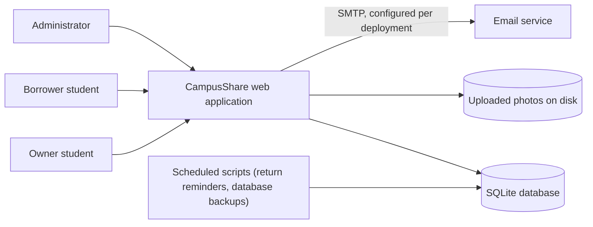
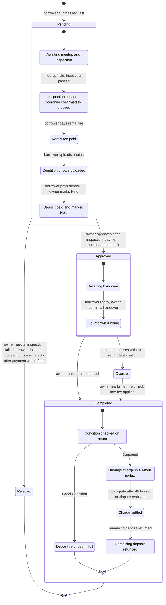
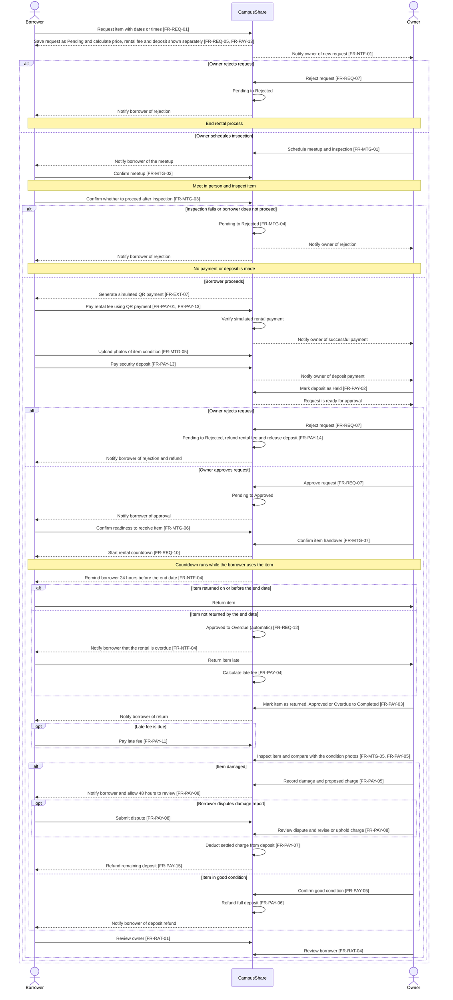
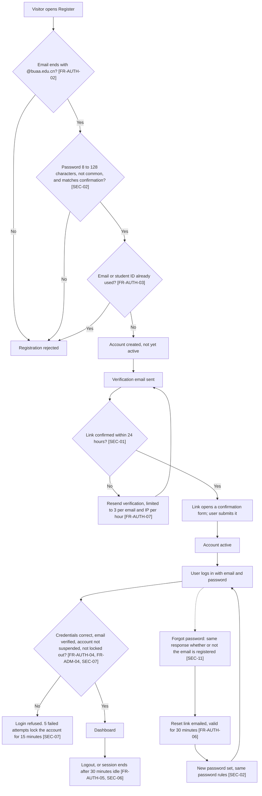

# CampusShare: Software Requirements Specification (SRS)

| | |
|---|---|
| **Project** | CampusShare (Team 26F) |
| **Document** | Software Requirements Specification |
| **Version** | v0.4 (draft for team review) |
| **Date** | 2026-11-03 |
| **Author** | Sandra Masiwa (system design and documentation) |
| **Team** | Turay Edward Joe (backend and business logic), Amanda Nancy Skaikay (requirements analysis and usability review), Sandra Masiwa (system design and documentation) |
| **Standard followed** | ISO/IEC/IEEE 29148:2018 (structure adapted for a course project) |
| **Application baseline** | Branch `joe-work` (snapshot dated 2026-10-26), reviewed 2026-10-27. Not yet merged into `main` |
| **Location** | `docs/requirements/SRS.md` |

## Revision history

| Version | Date | Author | Change |
|---|---|---|---|
| v0.1 | 2026-10-18 | Sandra Masiwa | First draft, based on review of the first prototype (`main`, commit `2403816`) and manual testing |
| v0.2 | 2026-10-22 | Sandra Masiwa | Statuses revised after retesting the first prototype; status legend extended |
| v0.3 | 2026-10-27 | Sandra Masiwa | Re-baselined against branch `joe-work`: statuses checked by running the 76 automated tests and reading the code; new requirements added for features built since v0.1; Appendix A rewritten to show what was resolved |
| v0.4 | 2026-11-03 | Sandra Masiwa | Responds to the peer-review issues from Team E and Team D (Appendix B). The borrowing lifecycle is reordered so that approval comes after inspection, payment, and deposit (sections 4.1 and 4.2, which now show every stage from request to completed, including inspection, payment, countdown, overdue, return, damage, and deposit refund). Added: meetup, inspection, and handover requirements; payment, deposit, and dispute rules aligned; interface requirements; data retention rules; a requirement-to-test table; withdrawn IDs list. Status values now use only the section 1.5 legend. They were mapped from evidence already in this document; the code was not re-run for v0.4, so items marked To verify need a check. Rules marked *(proposed, to confirm)* need a team decision (section 6.2). Appendix A states completed |

## Table of contents

1. [Introduction](#1-introduction)
2. [Overall description](#2-overall-description)
3. [Specific requirements](#3-specific-requirements)
4. [Process flows](#4-process-flows)
5. [Verification and traceability](#5-verification-and-traceability)
6. [Open issues for team decision](#6-open-issues-for-team-decision)
7. [Appendix A: Gaps found in the first prototype](#appendix-a-gaps-found-in-the-first-prototype)
8. [Appendix B: Peer-review findings and where v0.4 addresses them](#appendix-b-peer-review-findings-and-where-v04-addresses-them)
9. [Appendix C: Status changes from v0.3](#appendix-c-status-changes-from-v03)

---

## 1. Introduction

### 1.1 Purpose

This document specifies the requirements of CampusShare, a web application that lets Beihang University students lend and borrow equipment. It is written for the development team, the instructor, and the peer-review teams. It describes what the system must do, which requirements the current application already meets, and which it does not.

### 1.2 Scope

**CampusShare** lets a student list equipment they own, lets other students browse and request it, and supports the whole loan: approval, payment status, deposit handling, return, damage assessment and disputes, ratings, messaging, and notifications. An administrator role handles moderation. Before a rental is approved, the borrower and the owner meet in person to inspect the item.

**Out of scope for the current release:** real online payment processing (payments are simulated, see section 2.5), delivery or logistics, and users outside Beihang University. Real online payment is listed as future work in section 6.3.

### 1.3 Definitions

| Term | Meaning |
|---|---|
| Owner (lender) | A registered user who has listed an item |
| Borrower | A registered user who has requested an item |
| Listing | An equipment record created by an owner |
| Request / rental | A borrowing request, which becomes a rental once approved |
| Deposit | An amount set by the owner and held against damage or loss |
| Late fee | A charge for returning an item after the agreed end date |
| Rental fee | The price of borrowing the item for the agreed period. It does not include the deposit |
| Meetup and inspection | The in-person meeting where the borrower and owner check the item before the rental is confirmed |
| Condition photos | Photos of the item taken by the borrower before the rental starts, kept as evidence of its condition |
| Dispute | A borrower's objection to a damage report, raised within 48 hours of the report |
| Administrator | A user whose email is on the configured allowlist |
| SRS | Software Requirements Specification |

### 1.4 References

1. ISO/IEC/IEEE 29148:2018, *Systems and software engineering: Life cycle processes: Requirements engineering*
2. ISO/IEC/IEEE 42010:2022, *Architecture description*
3. Software Engineering GitHub Operations Guide (course)
4. `docs/requirements/user-roles-and-permissions.md` (roles and permissions detail)
5. `docs/design/design.md` (architecture and design description)
6. Source code and README of branch `joe-work`

### 1.5 Conventions

- Requirements use the word **shall**. Each has a unique ID.
- **ID format:** `FR-<area>-<nn>` for functional, `SEC-<nn>` for security, `NFR-<area>-<nn>` for non-functional.
- **Priority** (MoSCoW): **M** = Must, **S** = Should, **C** = Could, **W** = Won't (agreed not to be built in the current release). No requirement currently has priority W; items that were dropped are listed in section 3.7 and section 6.3.
- **Status** of the current application:
  - **Done**: works as specified, confirmed by an automated test, by running the code, or by reading it (see section 5.2).
  - **Partial**: works in part, or works with a known limitation.
  - **Missing**: not implemented.
  - **To verify**: not yet confirmed.
  - **Under study**: the team is assessing whether it is feasible.
- **Verification** method planned: **T** = test, **D** = demonstration, **I** = inspection of code or documents.
- Only the five status values above are used. IDs are never reused or renumbered. IDs that were withdrawn or merged are listed in section 3.7.
- A rule marked *(proposed, to confirm)* has not yet been agreed by the team. Section 6.2 lists the matching questions.

### 1.6 Overview

Section 2 describes the product and its users. Section 3 lists the requirements. Section 4 shows the main process flows. Section 5 explains how requirements are verified. Section 6 lists decisions for the team. The appendix records the gaps found in the first prototype and what became of them.

---

## 2. Overall description

### 2.1 Product perspective

CampusShare is a standalone web application. Users access it through a browser. The server stores all data in a single SQLite database file and uploaded photos on local disk. Email is sent through an SMTP service configured at deployment. The simulated QR payment is served by the application itself and is not an external interface. Section 3.1 has one requirement for each interface.

### 2.2 Product functions (summary)

1. Register with email confirmation, log in, log out, and reset a password
2. Create, edit, and delete equipment listings with photos, priced per day or per hour
3. Browse, search, and filter listings
4. Request equipment for a date range or time range, with a live cost estimate
5. Reject a request, or arrange a meetup and inspection and, after inspection, payment, and deposit, approve it (owner)
6. Pay the rental fee and deposit, upload condition photos, and record return, late fees, damage, and disputes
7. Review owners and borrowers after completed rentals
8. Message other students, including from an item or a request, and see unread counts
9. Receive in-app notifications, optional email notifications, and return reminders
10. Administer the platform: remove listings, suspend accounts, resolve damage disputes

### 2.3 User classes

CampusShare has one account type with a role field. Full detail is in `user-roles-and-permissions.md`.

| Role | Description |
|---|---|
| Visitor | Not logged in. Can view the home and browse pages and register or log in |
| Registered user | Logged-in student whose university email is confirmed (the student ID is recorded but not verified). Can list items, request items, message, and review |
| Owner | Registered user who owns a given listing. Can reject requests, schedule inspections, approve rentals, complete rentals, and handle deposits and damage for that listing |
| Borrower | Registered user who made a given request. Can confirm inspection, pay, upload condition photos, dispute damage reports, and review |
| Administrator | Provisioned only from the `CAMPUSSHARE_ADMIN_EMAILS` allowlist. Can remove listings, suspend non-administrator accounts, and resolve damage disputes that the owner and borrower have not settled (section 6.2, question 9) |

### 2.4 Operating environment

- Python 3.9 or newer with Flask 3.1.3, Flask-WTF 1.2.2, and qrcode with Pillow (listed in `requirements.txt`)
- SQLite database file `campusshare.db`, created on first run
- Developed on Windows with Python 3.14; a macOS run was reported; the automated tests also passed on Linux with Python 3.12 in the reviewer's run
- The development server binds to `127.0.0.1` only. Deployment requires a production server behind an HTTPS proxy (see SEC-12)

### 2.5 Constraints

- Registration is limited to Beihang University email addresses (`@buaa.edu.cn`).
- The project is developed by a student team within one semester. Deadlines: SRS in Week 7, design in Week 11, product launch in Week 16.
- No real payment gateway is available to the team. Payments are simulated, and real online payment is out of scope for the current release.
- **Database:** all persistent data is kept in a relational database (SQLite). This was requirement FR-EXT-02 in v0.3 and is a design constraint, not an interface.
- **Identity check:** the current release confirms only that a user owns a `@buaa.edu.cn` email address. No authoritative source is available to check student IDs.

### 2.6 Assumptions and dependencies

- Users meet in person to inspect the item, hand it over, and return it. The system records the loan but does not move the item.
- A working SMTP account is needed for verification, password-reset, and notification emails.
- Return reminders and database backups need an operating-system scheduler. Scripts are provided for Windows.

---

## 3. Specific requirements

### 3.1 External interfaces

| ID | Requirement | Pri | Status | Ver |
|---|---|---|---|---|
| FR-EXT-01 | The system shall provide a browser-based user interface for all functions, supported in the current versions of Chrome, Edge, Firefox, and Safari. *(browser list proposed, to confirm; section 6.2, question 13)* | M | To verify | D |
| FR-EXT-03 | The system shall send email to users for account verification, password reset, and optional notifications. If the mail service is unavailable, the system shall still complete the user's action and tell the user that the email could not be sent. *(unavailable-service behavior proposed, to confirm)* | M | Partial | T |
| FR-EXT-04 | The system shall keep persistent data in one SQLite database file. If the database cannot be opened or written, the system shall show a styled error page and make no partial change. *(error behavior proposed, to confirm)* | M | To verify | T |
| FR-EXT-05 | The system shall store uploaded photos on local disk. If a stored photo is missing, the system shall show the page without it instead of failing. *(proposed, to confirm)* | S | To verify | T |
| FR-EXT-06 | The system shall run return reminders and database backups through scripts started by the operating-system scheduler. The system shall work normally when the scheduler is not set up; reminders and backups then do not run. | S | Partial | I |
| FR-EXT-07 | The system shall provide the simulated payment as a QR-code link served by the application. Opening the link records the payment as Paid, the link expires after 10 minutes, and no money moves. | M | To verify | T |

*FR-EXT-02 note:* withdrawn in v0.4 and moved to the constraints in section 2.5 (section 3.7).

*FR-EXT-06 note:* scripts exist for Windows only (G-25).

*FR-EXT-03 note:* email sending is implemented and tested with a simulated mail server. Delivery through a real SMTP account to a real inbox has not been verified (README, "Still to do").

### 3.2 Functional requirements

#### 3.2.1 Accounts and authentication

| ID | Requirement | Pri | Status | Ver |
|---|---|---|---|---|
| FR-AUTH-01 | The system shall let a visitor register by providing name, university email, student ID, password, and password confirmation. | M | Done | T |
| FR-AUTH-02 | The system shall accept registration only for email addresses ending in `@buaa.edu.cn`. | M | Done | T |
| FR-AUTH-03 | The system shall reject registration if the email or student ID is already registered. | M | Done | T |
| FR-AUTH-04 | The system shall let a user with a verified, non-suspended account log in with email and password, ignoring letter case in the email. | M | Done | T |
| FR-AUTH-05 | The system shall end the user's session on logout, and logout shall require a form submission protected against forgery. | M | Done | T |
| FR-AUTH-06 | The system shall let a user reset a forgotten password using a link sent to the registered email, valid for 30 minutes and usable once. | M | Partial | T |
| FR-AUTH-07 | The system shall let a user request a new verification email, limited to three requests per email and IP address per hour. | S | Partial | T |

*FR-AUTH-06 team comment:* Code was written but is not functional; this depends on access to the SMTP server.

*FR-AUTH-07 team comment:* Structure implemented but not functional; depends on access to the SMTP server.

*FR-AUTH-06 note:* the link is emailed (no longer printed to the console) and expires after 30 minutes, but the code does not invalidate it after use, so it can be reused within the time limit.

#### 3.2.2 Equipment listings

| ID | Requirement | Pri | Status | Ver |
|---|---|---|---|---|
| FR-LST-01 | The system shall let a registered user create a listing with name, category, description, condition, sharing type (Free or Paid), price per day or per hour, deposit, availability dates, daily pickup and return times (hourly listings), and location. | M | Done | T |
| FR-LST-02 | The system shall reject a listing whose availability end date is before its start date. | M | Done | T |
| FR-LST-03 | The system shall reject a listing whose availability start date is in the past. | M | Done | T |
| FR-LST-04 | The system shall let an owner edit their own listings. | M | Done | T |
| FR-LST-05 | The system shall prevent deletion of a listing that has rental request history. | M | Done | T |
| FR-LST-06 | The system shall show each listing's status as Available (no Pending or Approved request), Pending (at least one Pending request and none Approved), or Booked (at least one Approved request). *(current behavior; section 6.2, question 5)* | M | Done | T |
| FR-LST-07 | The system shall let an owner upload, replace, and remove a photo for a listing (JPG, PNG, or WebP, at most 5 MB, checked by file content). | S | Done | T |
| FR-LST-08 | The system shall let an owner offer hourly rentals within a daily pickup and return window. | S | Done | T |
| FR-LST-09 | The system shall not let an owner edit a listing while it has a Pending, Approved, or Overdue request. *(scope of the restriction proposed, to confirm)* | M | Missing | T |

*FR-LST-04 team comment:* Need to block the owner from editing a listing during a booking. This is now requirement FR-LST-09 (v0.4). The price and deposit of a request are saved when the request is created (FR-REQ-05), so later edits do not change a request already made.

*FR-LST-06 note:* a listing shows Booked as soon as it has one approved request, even if other dates are free (see section 6).

*FR-LST-07 note:* photos are stored on local disk, excluded from Git, and not covered by the database backup. This also makes the system slow.

#### 3.2.3 Browse and search

| ID | Requirement | Pri | Status | Ver |
|---|---|---|---|---|
| FR-BRW-01 | The system shall list equipment, newest first. | M | Done | T |
| FR-BRW-02 | The system shall search listings by keyword in name, category, and description. | M | Done | T |
| FR-BRW-03 | The system shall filter listings by category and by status. | M | Done | T |
| FR-BRW-04 | The system shall show a detail page with description, condition, price, deposit, availability, location, owner name, photo, and status. | M | Done | T |
| FR-BRW-05 | The system shall not count a listing as available once its availability end date has passed. | S | Done | T |
| FR-BRW-06 | The system shall show results in pages of 24 listings and keep the search filters between pages. | S | To verify | T |

*FR-BRW-06 team comment:* We do not have enough listings to verify this yet.

#### 3.2.4 Borrowing requests

| ID | Requirement | Pri | Status | Ver |
|---|---|---|---|---|
| FR-REQ-01 | The system shall let a logged-in user request a listing for a date range, or for a time range on one day for hourly listings. | M | Done | T |
| FR-REQ-02 | The system shall reject a request on the user's own listing. | M | Done | T |
| FR-REQ-04 | The system shall reject a request that overlaps an existing pending or approved booking of the same listing. | M | Done | T |
| FR-REQ-05 | The system shall calculate the rental fee from the saved rate: whole days for daily rentals; for hourly rentals, the duration in hours and minutes multiplied by the hourly rate, with a minimum billable duration of 1 hour; zero for Free listings. The deposit is not part of the rental fee. *(minimum duration and per-minute rule proposed, to confirm; section 6.2, question 12)* | M | Partial | T |
| FR-REQ-06 | The system shall show the borrower a running cost estimate while they choose dates or times, before they submit. | S | Done | D |
| FR-REQ-07 | The system shall let an owner reject a request only while it is Pending. The system shall let an owner approve a request only while it is Pending, and only after the borrower has confirmed the inspection (FR-MTG-03), the rental fee is Paid, condition photos are uploaded (FR-MTG-05), and the deposit is Held (FR-PAY-02). | M | To verify | T |
| FR-REQ-08 | The system shall allow only the status changes shown in section 4.1 and listed in the table below, and shall refuse every other change. | M | Partial | T |
| FR-REQ-09 | The system shall allow several non-overlapping bookings of one listing. | S | Done | T |
| FR-REQ-10 | The system shall show a borrower the time remaining on an approved rental, counted from the owner's confirmation of handover (FR-MTG-07) to the agreed end. | C | To verify | T |
| FR-REQ-11 | The system shall check for an overlapping booking and save a new request in a single step, so that two simultaneous requests for overlapping times cannot both be saved. | M | To verify | T |
| FR-REQ-12 | The system shall change an Approved rental to Overdue automatically when its end date has passed without a return. (Merged from FR-PAY-09 in v0.4.) | M | To verify | T |

*FR-REQ-05 team comment:* Need to narrow the calculation down to minutes.

*FR-REQ-08 team comment:* Need to test the Overdue status.

*FR-REQ-05 examples:* at 10 per hour, a 90-minute rental costs 15 and a 30-minute rental costs 10 (the 1-hour minimum). At 10 per day, 3 days cost 30 (TC-05).

*FR-REQ-07 note:* v0.3 showed approval before the meetup, which broke the lifecycle in section 4.1. In v0.4 approval is the last step before handover. Reviewers report that the code already works in this order; the team is to confirm this against the code.

**Status changes allowed by FR-REQ-08** (one row per change, so that each has its own status):

| Change | Governing requirement | Status |
|---|---|---|
| Pending to Approved | FR-REQ-07 | To verify |
| Pending to Rejected | FR-REQ-07, FR-MTG-04, FR-PAY-14 | Partial |
| Approved to Overdue | FR-REQ-12 | To verify |
| Approved to Completed | FR-PAY-03 | Done |
| Overdue to Completed | FR-PAY-03 | To verify |

#### 3.2.5 Payment, return, deposit, and damage

| ID | Requirement | Pri | Status | Ver |
|---|---|---|---|---|
| FR-PAY-01 | The system shall record the payment status (Unpaid or Paid) of each request. | M | Done | T |
| FR-PAY-02 | The system shall let the owner mark the deposit as Held only after the rental fee is recorded as Paid and the borrower has paid the deposit. | M | To verify | T |
| FR-PAY-03 | The system shall let the owner mark an approved or overdue rental as returned (Completed), only after handover has been confirmed (FR-MTG-07). | M | Partial | T |
| FR-PAY-04 | The system shall calculate a late fee at return as the saved rate multiplied by the whole days after the agreed end date. | M | To verify | T |
| FR-PAY-05 | The system shall let the owner record the item's condition on return as Good Condition, or as Damaged with a description and a non-negative charge within the held deposit. | M | Done | T |
| FR-PAY-06 | The system shall let the owner record the refund of the full deposit only when the rental is Completed, the deposit is Held, and the condition is Good Condition. | M | Done | T |
| FR-PAY-07 | The system shall apply a damage charge against the held deposit only after the 48-hour review period has ended without a dispute, or after a dispute has been resolved (FR-PAY-08). | S | To verify | T |
| FR-PAY-08 | The system shall let the borrower view a damage report and dispute it within 48 hours of the report being recorded. If the borrower disputes it, the owner shall review the dispute, revise or uphold the charge, and the outcome shall be recorded (see FR-ADM-03 and section 6.2, question 9). | S | Partial | T |
| FR-PAY-11 | The system shall let the borrower pay a late fee after the rental is completed. | S | To verify | T |
| FR-PAY-12 | The system shall not let a rental with a price above zero be marked returned until its payment is recorded as Paid. | M | Done | T |
| FR-PAY-13 | The system shall show the rental fee and the security deposit as separate amounts, state that the deposit is not part of the rental fee, and let the borrower pay in this order: the rental fee after confirming to proceed (FR-MTG-03), then condition photos (FR-MTG-05), then the deposit. | M | To verify | T |
| FR-PAY-14 | The system shall refund the rental fee and release the deposit if the owner rejects a request after the borrower has paid. | M | Missing | T |
| FR-PAY-15 | The system shall refund the remaining deposit (the held deposit minus the settled damage charge) to the borrower after a damage charge is settled. | M | To verify | T |

*FR-PAY-03 team comment:* Need to work on the Overdue module.

*FR-PAY-11 team comment:* Structure is done but still needs testing.

*FR-PAY-01 note:* payment is simulated (see FR-EXT-07). The borrower confirms by opening a QR code link that expires after 10 minutes. No money moves.

*FR-PAY-09 and FR-PAY-10:* FR-PAY-09 was merged into FR-REQ-12 and FR-PAY-10 was withdrawn because real online payment is out of scope (section 3.7).

*FR-PAY-14 and FR-PAY-15 note:* refunds are records in the system. No money moves.

#### 3.2.6 Ratings and reviews

| ID | Requirement | Pri | Status | Ver |
|---|---|---|---|---|
| FR-RAT-01 | The system shall let a borrower rate the owner from 1 to 5 stars with a comment, once per completed rental. | M | Done | T |
| FR-RAT-02 | The system shall let a user view the reviews they have received. | M | Done | T |
| FR-RAT-03 | The system shall show each user's average received rating on their dashboard. | S | Done | T |
| FR-RAT-04 | The system shall let an owner rate the borrower, once per completed rental. | C | Done | T |

#### 3.2.7 Messaging

| ID | Requirement | Pri | Status | Ver |
|---|---|---|---|---|
| FR-MSG-01 | The system shall let a registered user send a text message of up to 1,000 characters to another registered user. | M | Done | T |
| FR-MSG-02 | The system shall show a list of conversations with the latest message and unread count. | M | Done | T |
| FR-MSG-03 | The system shall mark messages as read when the recipient opens the conversation. | M | Done | T |
| FR-MSG-04 | The system shall let a user delete only messages they sent. | S | Missing | T |
| FR-MSG-05 | The system shall let a borrower start a conversation with an item's owner from the item page (Message Owner button). | S | Done | T |
| FR-MSG-06 | The system shall let an owner start a conversation with a borrower from a request (Message Borrower link). | S | Done | T |

*FR-MSG-06 note:* confirmed by reading the code; the reviewer's script checked the Message Owner path.

#### 3.2.8 Notifications and reminders

| ID | Requirement | Pri | Status | Ver |
|---|---|---|---|---|
| FR-NTF-01 | The system shall create a notification for the relevant user when a request is received, approved, or rejected, and when a rental is paid, returned, assessed for damage, disputed, or overdue. | M | Partial | T |
| FR-NTF-02 | The system shall create a notification when a user receives a new message. | M | Done | T |
| FR-NTF-03 | The system shall let a user mark their own notifications as read. | M | Done | T |
| FR-NTF-04 | The system shall remind a borrower 24 hours before the end date and when a rental becomes overdue. | S | Partial | T |
| FR-NTF-05 | The system shall offer email delivery of notifications, off by default and sent only to verified addresses. | C | Partial | D |
| FR-NTF-06 | The system shall show the number of unread private messages as a badge, and remove it when the messages are read. | S | Done | T |
| FR-NTF-07 | The system shall show the number of unread notifications as a badge. | S | Done | T |

*FR-NTF-01 team comment:* Need to work on the Overdue, dispute, and damage notifications.

*FR-NTF-05 note:* the same SMTP limitation as FR-EXT-03.

*FR-NTF-04 note:* status changed from Not Done to Partial because G-10 records the reminders as Partial (they need a scheduler) and the automated tests cover return reminders.

*FR-NTF-06 note:* the badge appears on the dashboard page (`dashboard.html`). Other pages were not checked.

#### 3.2.9 Administration

| ID | Requirement | Pri | Status | Ver |
|---|---|---|---|---|
| FR-ADM-01 | The system shall provide an Administrator role, assigned only from a configured allowlist and never selectable at registration. | S | Done | T |
| FR-ADM-02 | The system shall let an administrator remove listings from view and suspend or restore non-administrator accounts, without deleting rental history. | S | Done | T |
| FR-ADM-03 | The system shall let an administrator review and resolve damage-charge disputes that the owner and borrower have not settled (see FR-PAY-08 and section 6.2, question 9). | C | To verify | T |
| FR-ADM-04 | The system shall refuse login to suspended accounts and end their existing sessions on their next request. | S | Done | T |

*Documentation note:* the README lists administration both as completed and as "still to do". The code and tests show it is implemented, so v0.4 sets FR-ADM-01, FR-ADM-02, and FR-ADM-04 to Done and states that administrator moderation is part of the current release. FR-ADM-03 stays To verify until the dispute rule (section 6.2, question 9) is settled. The README should be corrected to say the same.

#### 3.2.10 Meetup, inspection, and handover

| ID | Requirement | Pri | Status | Ver |
|---|---|---|---|---|
| FR-MTG-01 | After a borrower submits a request, the system shall prompt the borrower and the owner to arrange a physical meetup, and shall let the owner either reject the request or schedule the meetup and inspection. | M | To verify | T |
| FR-MTG-02 | The system shall let the borrower confirm the scheduled meetup and inspection. | M | To verify | T |
| FR-MTG-03 | After the inspection, the system shall let the borrower confirm whether to proceed with the rental, and shall not accept payment or approval before that confirmation. | M | To verify | T |
| FR-MTG-04 | If the inspection fails or the borrower decides not to proceed, the system shall change the request from Pending to Rejected, notify both parties, and record no payment or deposit. | M | To verify | T |
| FR-MTG-05 | After the borrower has paid the rental fee, the system shall let the borrower upload photos of the item's condition (JPG, PNG, or WebP, at most 5 MB, checked by file content). The photos shall be linked to the request, visible to the borrower, the owner, and an administrator handling a dispute, and kept with the request so that they can be compared with the condition on return. | S | To verify | T |
| FR-MTG-06 | After approval, the system shall let the borrower confirm that they are ready to receive the item. | M | To verify | T |
| FR-MTG-07 | After approval, the system shall let the owner confirm that the item was handed over, shall start the rental countdown at that moment, and shall not offer Mark as Returned before handover is confirmed. | M | To verify | T |

*Prototype state:* Appendix A, G-31 records the meetup prompt and the condition photos as resolved, the borrower's confirmation to proceed as not resolved, and the rest as in development. The file size limit in FR-MTG-05 is taken from FR-LST-07.

*Open point:* the code is reported to refuse handover without inspection approval from both parties, while FR-MTG-03 names only the borrower (section 6.2, question 10).

### 3.3 Security requirements

| ID | Requirement | Pri | Status | Ver |
|---|---|---|---|---|
| SEC-01 | The system shall activate an account only after the user confirms, within 24 hours, a link sent to the registered university email. | M | Done | T |
| SEC-02 | The system shall require passwords of 8 to 128 characters that are not on a list of common passwords. | M | Done | T |
| SEC-03 | The system shall store passwords only as salted hashes. | M | To verify | I |
| SEC-04 | The system shall read its secret key from configuration outside the source code and refuse to start without it. | M | To verify | I |
| SEC-05 | The system shall protect every state-changing request against cross-site request forgery. | M | Done | T |
| SEC-06 | The system shall end sessions after 30 minutes of inactivity and shall set the cookie flags HttpOnly and SameSite, and Secure when served over HTTPS. | M | Done | T |
| SEC-07 | The system shall block further login attempts for 15 minutes after 5 failed attempts for the same account. | M | Done | T |
| SEC-08 | The system shall check on the server that the acting user owns the listing or request, and that the request is in a valid state, before any owner-only or borrower-only action. | M | Partial | T |
| SEC-09 | The system shall validate all input on the server (types, ranges, dates, lengths) and respond with a clear, styled error page instead of failing. | M | Partial | T |
| SEC-10 | The system shall use parameterized database queries for all data access. | M | Done | I |
| SEC-11 | The system shall make password-reset links single-use and shall not reveal whether an email is registered. | M | Partial | T |
| SEC-12 | The system shall bind the development server to the local machine only, and shall be served over HTTPS in deployment. | M | Partial | I |
| SEC-13 | The system shall show other users only a name, not an email address or student ID. | M | Done | T |
| SEC-14 | The system shall not write secrets, tokens, or reset links to logs or consoles. | M | Partial | T |
| SEC-15 | The system shall escape user-supplied text on every page to prevent script injection. | M | Done | I |
| SEC-16 | The system shall log security-relevant events (failed logins, approvals, deposit changes, damage decisions, dispute decisions) without recording credentials or personal text. | S | Missing | T |

*SEC-08 team comment:* Needs fixing. Status changed from Not Done to Partial because G-16 records that request status changes are now checked.

*SEC-11 team comment:* Needs BUAA SMTP access.

*SEC-14 note:* the reset link is no longer printed to the console (G-15); other secrets and tokens in logs have not been checked.

*SEC-03, SEC-04, SEC-16:* no evidence is recorded in this document yet. SEC-03 and SEC-04 need an inspection result (G-12 is To verify).

*SEC-01 note:* the logic is tested (TC-02). The student ID is recorded as a unique identifier but is not checked against any source, so the current release verifies only the university email (section 6.1). The 24-hour validity was shown in the account flow (section 4.3) but not stated here in v0.3.

*SEC-09 note:* many validations are tested (dates, amounts, files, passwords), but completeness for every field has not been demonstrated.

*SEC-11 note:* the reset response is the same for known and unknown emails (tested). Links are not invalidated after use.

*SEC-12 note:* the status stays Partial until an HTTPS deployment exists. The server binds to `127.0.0.1`, and production mode requires a trusted HTTPS proxy, redirects HTTP, and sets HSTS. No HTTPS deployment exists yet.

*SEC-15 note:* confirmed by inspection: templates use automatic escaping, and no template uses the `safe` filter.

### 3.4 Non-functional requirements

| ID | Requirement | Pri | Status | Ver |
|---|---|---|---|---|
| NFR-PERF-01 | The system shall return browse and search results within 2 seconds for 95% of requests with 1,000 listings and 50 simultaneous users. *(proposed target, to confirm)* | S | Partial | T |
| NFR-USE-01 | The system shall show validation messages beside the form fields, and prevent selecting past dates in date pickers. | S | Done | T |
| NFR-USE-02 | The system shall show consistently styled error pages instead of plain text messages. | S | Done | T |
| NFR-USE-03 | The system shall be usable on screens from 360 px wide. | S | To verify | D |
| NFR-REL-01 | The system shall enforce database referential integrity so that no record refers to a deleted record. | M | Done | T |
| NFR-REL-02 | The system shall back up the database at least once a day. Uploaded photos are not part of the backup in the current release (known limitation, G-26). | S | Partial | I |
| NFR-MNT-01 | The project shall provide a `requirements.txt` listing all dependencies. | M | Done | I |
| NFR-MNT-02 | The project shall split the application into modules and include automated tests for the request lifecycle and access control. | S | Done | I |
| NFR-POR-01 | The system shall run on macOS, Windows, and Linux with Python 3. | S | Done | D |

*NFR-PERF-01 note:* the benchmark `performance_test.py` uses an in-process test client. The developer measured p95 of about 0.88 seconds on Windows. The reviewer's run on Linux measured p95 of 1.37 seconds, which is within the target. This is not a real-network or production-host measurement, so the status is Partial: the target is met in the in-process benchmark only, and no deployment measurement exists. Whether the target itself is right is open (section 6.2, question 14).

*NFR-USE-03 note:* checked down to 450 px only.

*NFR-REL-02 note:* `database_backup.py` makes consistent copies and a Windows scheduler installer exists. On macOS and Linux the team must schedule it. Uploaded photos are not backed up.

*NFR-MNT-02 note:* 76 automated tests exist and pass. The application is split into `app.py`, `campusshare_routes.py`, and `database.py`, but the routes remain in one file of about 3,700 lines.

*NFR-POR-01 note:* macOS was reported by the team, Windows is the development system, and the test suite passed on Linux.

### 3.5 Data requirements

| Entity | Key attributes |
|---|---|
| users | id, name, email (unique), student_id (unique), password hash, email verified, role, suspended, email notifications enabled |
| equipment | id, owner, name, category, description, condition, sharing type, price, price unit, deposit, availability dates, pickup and return times, location, photo path, removed flag |
| borrowing_requests | id, equipment, borrower, start and end date and time, status, meetup and inspection details and confirmations, payment status, deposit status, price unit and rate (saved when the request is created), total price, late fee and its status, handover confirmation time, damage status, report, charge and report time, dispute status, reason, and resolution |
| rental_condition_photos | id, request, uploader, file path, upload time (see FR-MTG-05) |
| ratings | id, request, rater, rated user, rating (1 to 5), comment, time |
| messages | id, sender, receiver, text, time, read flag |
| notifications | id, user, message, link, read flag, time |
| rental_reminders | request, reminder type, time (prevents duplicate reminders) |
| login_attempts, verification_email_attempts | email, IP address, time (for throttling) |

Allowed values:

| Field | Values |
|---|---|
| Request status | Pending, Approved, Rejected, Overdue, Completed |
| Payment status | Unpaid, Paid |
| Deposit status | Pending (not yet paid), Held, Refunded (the full deposit, or what remains after a damage charge, has been returned), Settled (a damage charge has been applied to the deposit) *(meaning of Refunded and Settled proposed, to confirm)* |
| Damage status | Not Checked, Good Condition, Damaged |
| Dispute status | Not Disputed, Disputed, Resolved *(Disputed and Resolved proposed, to confirm)* |
| Dispute resolution | Charge upheld, Charge revised (with the new amount) *(proposed, to confirm)* |

### 3.6 Data retention and deletion

v0.3 had no rule for how long personal data is kept or how it is deleted. The periods below are proposed and need a team decision (section 6.2, question 11).

| ID | Requirement | Pri | Status | Ver |
|---|---|---|---|---|
| FR-DAT-01 | The system shall let a user request deletion of their account. On deletion the system shall remove the user's name, email, and student ID and show "Deleted user" instead, and shall keep the rental, payment, and rating records that the other party needs. | S | Missing | T |
| FR-DAT-02 | The system shall delete or anonymise each kind of data in the table below when its retention period ends. | S | Missing | T |

| Data | Purpose | Proposed retention | On account deletion |
|---|---|---|---|
| Account data (name, email, student ID, password hash) | Login and showing the owner or borrower name | While the account exists | Removed; shown as "Deleted user" |
| Listings and listing photos | Showing equipment | While the listing exists; a listing with request history is hidden, not deleted (FR-LST-05) | Listings are hidden |
| Rental requests, payments, deposits, damage reports, disputes, condition photos | Record of the loan and evidence | 24 months after the rental ends | Kept, with the user's name replaced |
| Messages and notifications | Communication | 12 months | The deleted user's messages are anonymised |
| Ratings | Trust between users | While the rated user's account exists | Kept, with the rater shown as "Deleted user" |
| Login and verification-email attempt records | Throttling | 24 hours | Not applicable |
| Rental reminder records | Prevent duplicate reminders | Until 30 days after the rental ends | Not applicable |
| Security log (SEC-16) | Audit | 90 days | Not applicable |
| Database backups | Recovery | The most recent 14 daily copies | Deleted data leaves the backups as old copies are replaced |

### 3.7 Withdrawn and merged IDs

| ID | What happened in v0.4 | Where it is now |
|---|---|---|
| FR-REQ-03 | Unused. The ID is kept unassigned so that existing references stay valid | None |
| FR-EXT-02 | Withdrawn: a design constraint, not an interface | Section 2.5, Database constraint |
| FR-PAY-09 | Merged: it duplicated the automatic Overdue rule | FR-REQ-12 |
| FR-PAY-10 | Withdrawn: real online payment is out of scope for the current release | Section 6.3, future work |
| Question 4 (section 6.2) | Number not used | None |

---

## 4. Process flows

### 4.1 Request lifecycle

The five request statuses (Pending, Approved, Rejected, Overdue, Completed) are the only values stored in the status field. The boxes inside Pending, Approved, and Completed are stages of the borrowing flow, not extra statuses. The table after the diagram links each stage to its statuses and requirements.

| Stage | Request status | Payment | Deposit status | Requirements |
|---|---|---|---|---|
| Request submitted, price calculated | Pending | Unpaid | Pending | FR-REQ-01, FR-REQ-05, FR-REQ-11 |
| Meetup arranged, inspection held, borrower confirms to proceed | Pending | Unpaid | Pending | FR-MTG-01, FR-MTG-02, FR-MTG-03 |
| Inspection fails or borrower does not proceed | Rejected | Unpaid | Pending | FR-MTG-04 |
| Rental fee paid | Pending | Paid | Pending | FR-PAY-13, FR-EXT-07 |
| Condition photos uploaded | Pending | Paid | Pending | FR-MTG-05 |
| Deposit paid and marked Held | Pending | Paid | Held | FR-PAY-02, FR-PAY-13 |
| Owner rejects after payment | Rejected | Paid, then refunded | Refunded | FR-PAY-14 |
| Owner approves | Approved | Paid | Held | FR-REQ-07 |
| Borrower ready, owner confirms handover, countdown starts | Approved | Paid | Held | FR-MTG-06, FR-MTG-07, FR-REQ-10 |
| Reminder 24 hours before the end date | Approved | Paid | Held | FR-NTF-04 |
| End date passes without return | Overdue | Paid | Held | FR-REQ-12, FR-NTF-04 |
| Owner marks item returned (from Approved or Overdue), late fee calculated | Completed | Paid | Held | FR-PAY-03, FR-PAY-04, FR-PAY-11 |
| Good Condition: full deposit refunded | Completed | Paid | Refunded | FR-PAY-05, FR-PAY-06 |
| Damaged: report recorded, 48-hour review, dispute if any, charge settled | Completed | Paid | Settled | FR-PAY-05, FR-PAY-07, FR-PAY-08 |
| Damaged: remaining deposit refunded | Completed | Paid | Refunded | FR-PAY-15 |

The status changes themselves are listed in section 3.2.4 (FR-REQ-08). Handover is confirmed after approval and starts the countdown. The meaning of the Refunded and Settled deposit values is proposed in section 3.5.

### 4.2 Main borrowing flow

Requirement IDs are shown in brackets next to the steps.

### 4.3 Account flow

Requirement IDs are shown in brackets next to the decisions.

---

## 5. Verification and traceability

### 5.1 Automated tests

The branch contains 76 automated tests, which all passed in the reviewer's run on 2026-10-27 (Linux, Python 3.12). They run with `python -m unittest discover -s tests -v` and use a temporary database. They cover registration and email verification, login lockout, sessions and cookies, CSRF, password rules, administrator actions, listing and rental validation, hourly and daily pricing, status transitions, late fees, payment, deposit and damage handling, disputes, ratings, notifications and email, return reminders, photo upload, database integrity, backups, and error pages.

### 5.2 Statuses confirmed without an automated test

| Requirement | How it was checked |
|---|---|
| FR-REQ-06 live cost estimate | Read the script in `item_details.html` |
| FR-MSG-05 Message Owner button | Reviewer script: button present; message sent; owner notified |
| FR-MSG-06 Message Borrower link | Read `requests.html` and the route |
| FR-MSG-03, FR-NTF-02, FR-NTF-06 | Reviewer script: unread count rose to 1, then cleared when the owner opened the chat |
| FR-NTF-07 | Read the code |
| SEC-10 no string-built SQL | Searched the code; none found |
| SEC-15 output escaping | No `safe` filter or `render_template_string` found |
| NFR-PERF-01 | Reviewer ran `performance_test.py` |

### 5.3 Acceptance test cases (manual)

| Test | Requirement | Expected result |
|---|---|---|
| TC-01 Register with a Gmail address | FR-AUTH-02 | Registration refused |
| TC-02 Register with a valid address, try to log in before confirming | SEC-01 | Login refused until the link is confirmed |
| TC-03 List an item starting yesterday | FR-LST-03 | Listing refused |
| TC-04 Request your own item | FR-REQ-02 | Request refused |
| TC-05 Request 3 days of a Paid item at 10 per day | FR-REQ-05 | Total price is 30 |
| TC-06 Request overlapping dates after an approved booking | FR-REQ-04 | Refused; non-overlapping dates accepted |
| TC-07 Try to approve a rejected request | FR-REQ-08 | Action refused |
| TC-08 Return an item 2 days late at 10 per day | FR-PAY-04 | Late fee is 20 |
| TC-09 Mark Damaged without a description | FR-PAY-05 | Refused with a message |
| TC-10 Open another user's edit page by its address | SEC-08 | Access refused |
| TC-11 Submit a form without a security token | SEC-05 | Request refused |
| TC-12 Six wrong passwords in a row | SEC-07 | Account locked for 15 minutes |
| TC-13 Send a message containing a script tag | SEC-15 | Shown as text, not run |
| TC-14 Use Message Owner, send a message, log in as the owner | FR-MSG-05, FR-NTF-06 | Owner sees a badge with 1 unread message |
| TC-15 Open the conversation as the owner | FR-NTF-06 | Badge disappears |
| TC-16 Use a password reset link twice | SEC-11 | Second use should be refused (currently accepted) |
| TC-17 View the app on a 360 px wide screen | NFR-USE-03 | No sideways scrolling |
| TC-18 Try to refund the deposit when the condition is Damaged, then when it is Good Condition and the rental is Completed | FR-PAY-06 | Refused when Damaged; accepted when Good Condition |
| TC-19 Start the application without a secret key configured | SEC-04 | The application refuses to start |
| TC-20 Request 90 minutes, then 30 minutes, of an hourly item at 10 per hour | FR-REQ-05 | Totals are 15 and 10 |
| TC-21 Report a failed inspection after the meetup | FR-MTG-04, FR-REQ-08 | Request becomes Rejected; no payment or deposit is recorded |
| TC-22 Owner tries to approve before the fee is Paid, and before the deposit is Held | FR-REQ-07, FR-PAY-02 | Approval refused both times |
| TC-23 Owner rejects after the borrower has paid | FR-PAY-14 | Request Rejected; rental fee refunded and deposit released |
| TC-24 Submit two overlapping requests at the same moment | FR-REQ-11, FR-REQ-04 | Only one request is saved |
| TC-25 Record damage, then check the deposit before 48 hours have passed | FR-PAY-07, FR-PAY-08 | Charge not applied until the review period ends or a dispute is resolved |
| TC-26 Dispute a damage report | FR-PAY-08 | Dispute recorded; owner revises or upholds; outcome recorded |
| TC-27 Open a verification link after 24 hours | SEC-01 | Link refused; a new email can be requested |
| TC-28 Try Mark as Returned before handover is confirmed | FR-MTG-07, FR-PAY-03 | Option not offered; action refused |
| TC-29 Owner edits a listing that has a Pending request | FR-LST-09 | Edit refused |
| TC-30 Open the main pages in Chrome, Edge, Firefox, and Safari | FR-EXT-01 | Pages work in each browser |
| TC-31 Request an item, wait for the QR link to expire (10 minutes), then open it | FR-EXT-07 | Payment is not recorded |

*TC-18 to TC-31 are new in v0.4 and have not been run yet.*

### 5.4 Requirement-to-test table

This table links every requirement to the evidence recorded for it. The 76 automated tests are described only by topic in section 5.1, so the second-last column shows the topic they fall under. The team should replace the topic with the test names (see the last column). Requirements marked "None recorded" have no recorded test or inspection yet.

| Requirement | Ver | Status | Recorded evidence | Action |
|---|---|---|---|---|
| FR-EXT-01 | D | To verify | Manual: TC-30 (new, not yet run) | Run the test case |
| FR-EXT-03 | T | Partial | Automated tests, topic: notifications and email | Name the automated test that covers it |
| FR-EXT-04 | T | To verify | None recorded | Add a test case or record an inspection result |
| FR-EXT-05 | T | To verify | None recorded | Add a test case or record an inspection result |
| FR-EXT-06 | I | Partial | None recorded | Add a test case or record an inspection result |
| FR-EXT-07 | T | To verify | Manual: TC-31 (new, not yet run) | Run the test case |
| FR-AUTH-01 | T | Done | Automated tests, topic: registration and email verification | Name the automated test that covers it |
| FR-AUTH-02 | T | Done | Manual: TC-01; Automated tests, topic: registration and email verification | None |
| FR-AUTH-03 | T | Done | Automated tests, topic: registration and email verification | Name the automated test that covers it |
| FR-AUTH-04 | T | Done | Automated tests, topic: registration and email verification | Name the automated test that covers it |
| FR-AUTH-05 | T | Done | Automated tests, topic: CSRF | Name the automated test that covers it |
| FR-AUTH-06 | T | Partial | Automated tests, topic: registration and email verification | Name the automated test that covers it |
| FR-AUTH-07 | T | Partial | Automated tests, topic: registration and email verification | Name the automated test that covers it |
| FR-LST-01 | T | Done | None recorded | Add a test case or record an inspection result |
| FR-LST-02 | T | Done | Automated tests, topic: listing and rental validation | Name the automated test that covers it |
| FR-LST-03 | T | Done | Manual: TC-03; Automated tests, topic: listing and rental validation | None |
| FR-LST-04 | T | Done | None recorded | Add a test case or record an inspection result |
| FR-LST-05 | T | Done | None recorded | Add a test case or record an inspection result |
| FR-LST-06 | T | Done | None recorded | Add a test case or record an inspection result |
| FR-LST-07 | T | Done | Automated tests, topic: photo upload | Name the automated test that covers it |
| FR-LST-08 | T | Done | None recorded | Add a test case or record an inspection result |
| FR-LST-09 | T | Missing | Manual: TC-29 (new, not yet run) | Run the test case |
| FR-BRW-01 | T | Done | None recorded | Add a test case or record an inspection result |
| FR-BRW-02 | T | Done | None recorded | Add a test case or record an inspection result |
| FR-BRW-03 | T | Done | None recorded | Add a test case or record an inspection result |
| FR-BRW-04 | T | Done | None recorded | Add a test case or record an inspection result |
| FR-BRW-05 | T | Done | None recorded | Add a test case or record an inspection result |
| FR-BRW-06 | T | To verify | None recorded | Add a test case or record an inspection result |
| FR-REQ-01 | T | Done | Automated tests, topic: listing and rental validation | Name the automated test that covers it |
| FR-REQ-02 | T | Done | Manual: TC-04; Automated tests, topic: listing and rental validation | None |
| FR-REQ-04 | T | Done | Manual: TC-06, TC-24; Automated tests, topic: listing and rental validation | None |
| FR-REQ-05 | T | Partial | Manual: TC-05, TC-20; Automated tests, topic: hourly and daily pricing | None |
| FR-REQ-06 | D | Done | Section 5.2: Read the script in `item_details.html` | None |
| FR-REQ-07 | T | To verify | Manual: TC-22; Automated tests, topic: status transitions | None |
| FR-REQ-08 | T | Partial | Manual: TC-07, TC-21; Automated tests, topic: status transitions | None |
| FR-REQ-09 | T | Done | Automated tests, topic: listing and rental validation | Name the automated test that covers it |
| FR-REQ-10 | T | To verify | None recorded | Add a test case or record an inspection result |
| FR-REQ-11 | T | To verify | Manual: TC-24 (new, not yet run) | Run the test case |
| FR-REQ-12 | T | To verify | Automated tests, topic: status transitions | Name the automated test that covers it |
| FR-PAY-01 | T | Done | Automated tests, topic: payment, deposit and damage handling | Name the automated test that covers it |
| FR-PAY-02 | T | To verify | Manual: TC-22; Automated tests, topic: payment, deposit and damage handling | None |
| FR-PAY-03 | T | Partial | Manual: TC-28; Automated tests, topic: payment, deposit and damage handling | None |
| FR-PAY-04 | T | To verify | Manual: TC-08; Automated tests, topic: late fees | None |
| FR-PAY-05 | T | Done | Manual: TC-09; Automated tests, topic: payment, deposit and damage handling | None |
| FR-PAY-06 | T | Done | Manual: TC-18; Automated tests, topic: payment, deposit and damage handling | None |
| FR-PAY-07 | T | To verify | Manual: TC-25; Automated tests, topic: payment, deposit and damage handling | None |
| FR-PAY-08 | T | Partial | Manual: TC-25, TC-26; Automated tests, topic: disputes | None |
| FR-PAY-11 | T | To verify | None recorded | Add a test case or record an inspection result |
| FR-PAY-12 | T | Done | Automated tests, topic: payment, deposit and damage handling | Name the automated test that covers it |
| FR-PAY-13 | T | To verify | None recorded | Add a test case or record an inspection result |
| FR-PAY-14 | T | Missing | Manual: TC-23 (new, not yet run) | Run the test case |
| FR-PAY-15 | T | To verify | None recorded | Add a test case or record an inspection result |
| FR-RAT-01 | T | Done | Automated tests, topic: ratings | Name the automated test that covers it |
| FR-RAT-02 | T | Done | Automated tests, topic: ratings | Name the automated test that covers it |
| FR-RAT-03 | T | Done | Automated tests, topic: ratings | Name the automated test that covers it |
| FR-RAT-04 | T | Done | Automated tests, topic: ratings | Name the automated test that covers it |
| FR-MSG-01 | T | Done | None recorded | Add a test case or record an inspection result |
| FR-MSG-02 | T | Done | None recorded | Add a test case or record an inspection result |
| FR-MSG-03 | T | Done | Section 5.2: Reviewer script: unread count rose to 1, then cleared when the owner opened the chat | None |
| FR-MSG-04 | T | Missing | None recorded | Add a test case or record an inspection result |
| FR-MSG-05 | T | Done | Manual: TC-14; Section 5.2: Reviewer script: button present; message sent; owner notified | None |
| FR-MSG-06 | T | Done | Section 5.2: Read `requests.html` and the route | None |
| FR-NTF-01 | T | Partial | Automated tests, topic: notifications and email | Name the automated test that covers it |
| FR-NTF-02 | T | Done | Section 5.2: Reviewer script: unread count rose to 1, then cleared when the owner opened the chat; Automated tests, topic: notifications and email | None |
| FR-NTF-03 | T | Done | Automated tests, topic: notifications and email | Name the automated test that covers it |
| FR-NTF-04 | T | Partial | Automated tests, topic: return reminders | Name the automated test that covers it |
| FR-NTF-05 | D | Partial | None recorded | Add a test case or record an inspection result |
| FR-NTF-06 | T | Done | Manual: TC-14, TC-15; Section 5.2: Reviewer script: unread count rose to 1, then cleared when the owner opened the chat | None |
| FR-NTF-07 | T | Done | Section 5.2: Read the code | None |
| FR-ADM-01 | T | Done | Automated tests, topic: administrator actions | Name the automated test that covers it |
| FR-ADM-02 | T | Done | Automated tests, topic: administrator actions | Name the automated test that covers it |
| FR-ADM-03 | T | To verify | Automated tests, topic: administrator actions | Name the automated test that covers it |
| FR-ADM-04 | T | Done | Automated tests, topic: administrator actions | Name the automated test that covers it |
| FR-MTG-01 | T | To verify | None recorded | Add a test case or record an inspection result |
| FR-MTG-02 | T | To verify | None recorded | Add a test case or record an inspection result |
| FR-MTG-03 | T | To verify | None recorded | Add a test case or record an inspection result |
| FR-MTG-04 | T | To verify | Manual: TC-21 (new, not yet run) | Run the test case |
| FR-MTG-05 | T | To verify | None recorded | Add a test case or record an inspection result |
| FR-MTG-06 | T | To verify | None recorded | Add a test case or record an inspection result |
| FR-MTG-07 | T | To verify | Manual: TC-28 (new, not yet run) | Run the test case |
| SEC-01 | T | Done | Manual: TC-02, TC-27; Automated tests, topic: registration and email verification | None |
| SEC-02 | T | Done | Automated tests, topic: password rules | Name the automated test that covers it |
| SEC-03 | I | To verify | None recorded | Add a test case or record an inspection result |
| SEC-04 | I | To verify | Manual: TC-19 (new, not yet run) | Run the test case |
| SEC-05 | T | Done | Manual: TC-11; Automated tests, topic: CSRF | None |
| SEC-06 | T | Done | Automated tests, topic: sessions and cookies | Name the automated test that covers it |
| SEC-07 | T | Done | Manual: TC-12; Automated tests, topic: login lockout | None |
| SEC-08 | T | Partial | Manual: TC-10 | None |
| SEC-09 | T | Partial | Automated tests, topic: listing and rental validation | Name the automated test that covers it |
| SEC-10 | I | Done | Section 5.2: Searched the code; none found | None |
| SEC-11 | T | Partial | Manual: TC-16 | None |
| SEC-12 | I | Partial | None recorded | Add a test case or record an inspection result |
| SEC-13 | T | Done | None recorded | Add a test case or record an inspection result |
| SEC-14 | T | Partial | None recorded | Add a test case or record an inspection result |
| SEC-15 | I | Done | Manual: TC-13; Section 5.2: No `safe` filter or `render_template_string` found | None |
| SEC-16 | T | Missing | None recorded | Add a test case or record an inspection result |
| NFR-PERF-01 | T | Partial | Section 5.2: Reviewer ran `performance_test.py` | None |
| NFR-USE-01 | T | Done | None recorded | Add a test case or record an inspection result |
| NFR-USE-02 | T | Done | Automated tests, topic: error pages | Name the automated test that covers it |
| NFR-USE-03 | D | To verify | Manual: TC-17 | None |
| NFR-REL-01 | T | Done | Automated tests, topic: database integrity | Name the automated test that covers it |
| NFR-REL-02 | I | Partial | Automated tests, topic: backups | Name the automated test that covers it |
| NFR-MNT-01 | I | Done | None recorded | Add a test case or record an inspection result |
| NFR-MNT-02 | I | Done | None recorded | Add a test case or record an inspection result |
| NFR-POR-01 | D | Done | None recorded | Add a test case or record an inspection result |
| FR-DAT-01 | T | Missing | None recorded | Add a test case or record an inspection result |
| FR-DAT-02 | T | Missing | None recorded | Add a test case or record an inspection result |

---

## 6. Open issues for team decision

### 6.1 Decisions settled

The decisions below are settled by the implementation or by the team's review of v0.3. Please confirm each one.

| Decision | Where it applies |
|---|---|
| Hourly borrowing is in scope and built | FR-LST-08, FR-REQ-05 |
| Real online payment is out of scope for the current release. Payments are simulated (previously question 2) | Section 1.2, section 2.5, section 6.3 |
| The current release confirms only the university email. The student ID is recorded but not verified, because no authoritative source is available (previously question 3) | SEC-01, section 2.3 |
| Administrator moderation is part of the current release | FR-ADM-01 to FR-ADM-04 |
| The owner approves only after inspection, payment, condition photos, and deposit. Before that, the owner can reject or schedule the inspection | Section 4.1, section 4.2, FR-REQ-07, FR-MTG-01 to FR-MTG-07 |
| The borrower pays in this order: rental fee, then condition photos, then deposit | FR-PAY-13, FR-MTG-05 |
| Uploaded photos are not part of the database backup in the current release | NFR-REL-02, G-26 |

### 6.2 Questions still open, also open to reviewers

| # | Question | Why it matters |
|---|---|---|
| 1 | Should browsing stay public? | Visitors can open the browse page without logging in |
| 5 | Should a listing with one booking still show Booked for its free dates? | Now that several bookings are allowed, the label may mislead (FR-LST-06) |
| 6 | Who sets up HTTPS, SMTP, and the schedulers for the demonstration? | SEC-12, FR-EXT-03, FR-NTF-04, and NFR-REL-02 depend on it |
| 7 | Should password-reset links be invalidated after use? | Closes the remaining part of SEC-11 |
| 8 | Which `Partial` and `To verify` items will be finished before Week 16? | Fixes the scope for the demonstration |
| 9 | Who decides a damage dispute: the owner alone, or the administrator when the owner and borrower do not agree? | FR-PAY-08 and FR-ADM-03 currently describe different deciders |
| 10 | Does handover need inspection approval from both the borrower and the owner, or from the borrower only? | The code is reported to need both; FR-MTG-03 names only the borrower |
| 11 | Are the proposed data retention periods in section 3.6 acceptable? | Fixes FR-DAT-01 and FR-DAT-02 |
| 12 | Is the hourly rule right: per-minute pricing with a 1-hour minimum? | Fixes FR-REQ-05 and TC-20 |
| 13 | Which browsers must the demonstration support? | Fixes FR-EXT-01 and TC-30 |
| 14 | Is the performance target (2 seconds for 95% of requests, 1,000 listings, 50 users) the right target? | NFR-PERF-01 was marked *proposed* in v0.3 |

Question 4 is not used (section 3.7). Questions 2 and 3 were settled and moved to section 6.1.

### 6.3 Future work

| Item | Reason |
|---|---|
| Real online payment through an external provider (was FR-PAY-10) | No payment gateway is available to the team (section 2.5) |

---

## Appendix A: Gaps found in the first prototype

The first review (v0.1, 2026-10-17 and 2026-10-18) found these gaps in `main`. The fourth column shows their state on branch `joe-work`.

| ID | Observation in the first prototype | State on `joe-work` | Requirement |
|---|---|---|---|
| G-01 | A made-up `@buaa.edu.cn` email and student ID were accepted | Partly resolved: email must be confirmed; student ID still unchecked | SEC-01 |
| G-02 | Past dates could be chosen as availability dates | Resolved | FR-LST-03 |
| G-03 | Validation messages appeared only after submission | Resolved: errors beside fields, values kept | NFR-USE-01 |
| G-04 | No option to upload an image | Resolved | FR-LST-07 |
| G-05 | Unexpected logouts while moving between pages | Open to verify: sessions now expire after 30 minutes idle by design; cause of the earlier logouts not confirmed | SEC-06 |
| G-06 | Any password was accepted | Resolved | SEC-02 |
| G-07 | No time of day, so hourly borrowing was impossible | Resolved | FR-LST-08 |
| G-08 | Damage button failed; no countdown or overdue state | Resolved | FR-PAY-05, FR-REQ-10, FR-PAY-09 |
| G-09 | No notification when a request arrived or changed | Resolved | FR-NTF-01 |
| G-10 | No live cost calculator and no reminders | Cost estimate resolved; reminders Partial (need a scheduler) | FR-REQ-06, FR-NTF-04 |
| G-11 | No in-app payment; Paid was only a label | Partly resolved: simulated QR payment; no real money | FR-PAY-01, FR-PAY-10 |
| G-12 | Secret key written in the source | To verify | SEC-04 |
| G-13 | No CSRF protection | Resolved | SEC-05 |
| G-14 | Student directory showed every user's name and email | Resolved | SEC-13 |
| G-15 | Reset link printed to the console and reusable | Partly resolved: emailed and not printed; still reusable | FR-AUTH-06, SEC-11, SEC-14 |
| G-16 | Request status changes were not checked | Resolved | FR-REQ-08 |
| G-17 | Deleting a listing deleted its rental history | Resolved | FR-LST-05 |
| G-18 | Server listened on all network addresses | To verify | SEC-12 |
| G-19 | Foreign keys were not enforced | To verify | NFR-REL-01 |
| G-20 | No `requirements.txt` | Resolved | NFR-MNT-01 |
| G-21 | Rating reported as not implemented at retest | Resolved: both parties can review | FR-RAT-01, FR-RAT-04 |
| G-22 | Retest on `main` (2026-10-22): editing listings, price, late fee, reviews, and message notifications did not work | Resolved on `joe-work` | FR-LST-04, FR-REQ-05, FR-PAY-04, FR-RAT-02, FR-NTF-02 |

### Gaps found in the 2026-10-27 review of the latest prototype

| ID | Observation | Requirement | State |
|---|---|---|---|
| G-23 | Password-reset links are not invalidated after use | SEC-11, FR-AUTH-06 | Not resolved |
| G-24 | Email delivery through a real SMTP account has not been verified | FR-EXT-03, FR-NTF-05 | Not resolved; needs SMTP access |
| G-25 | Return reminders and database backups need a scheduler; scripts exist for Windows only | FR-NTF-04, NFR-REL-02, FR-EXT-06 | Partly resolved: Windows scripts exist; macOS and Linux need manual scheduling |
| G-26 | Uploaded photos are stored on local disk and are not backed up | FR-LST-07, NFR-REL-02, FR-EXT-05 | Known limitation, documented in v0.4 (section 6.1) |
| G-27 | The unread message badge appears only on the dashboard page | FR-NTF-06 | Resolved |
| G-28 | All route handlers are in one file of about 3,700 lines | NFR-MNT-02 | Not resolved |
| G-29 | The 360 px screen width has not been tested | NFR-USE-03 | To verify |
| G-30 | A listing shows Booked after one approved request, even when other dates are free | FR-LST-06 | Not resolved |
| G-31 | Rental workflow items in development (detail below) | FR-MTG-01 to FR-MTG-07, FR-PAY-13 to FR-PAY-15, FR-REQ-07 | In development; requirements added in v0.4 |

#### G-31: Rental workflow items in development

States marked "revised in v0.4" show where the v0.4 workflow differs from the wording recorded in v0.3.

| # | Area | Item | Requirement | State |
|---|---|---|---|---|
| 1 | Security deposit display | The item description should display the required security deposit. | FR-BRW-04 | Not resolved (v0.3 record; FR-BRW-04 lists the deposit, so re-check) |
| 1 | Security deposit display | The estimated rental cost should clearly state that the security deposit is not included in the rental fee. | FR-PAY-13, FR-REQ-06 | Resolved |
| 2 | Meetup and physical inspection | Once a borrower requests an item, the system should prompt the borrower and owner to arrange a physical meetup. | FR-MTG-01 | Resolved |
| 2 | Meetup and physical inspection | Both parties must meet and inspect the item before the rental is confirmed. | FR-MTG-01, FR-MTG-02, FR-REQ-07 | In development |
| 2 | Meetup and physical inspection | The borrower should confirm whether they wish to proceed after inspecting the item. | FR-MTG-03 | Not resolved |
| 3 | Item condition documentation | If the borrower agrees to proceed, they should be able to take and upload pictures of the item's current condition. | FR-MTG-05 | Resolved (revised in v0.4: pictures are uploaded after the rental fee is paid and before the deposit) |
| 3 | Item condition documentation | These pictures will serve as evidence of the item's condition at the time of collection and can be compared against its condition upon return. | FR-MTG-05, FR-PAY-05 | In development |
| 4 | Rental payment | After documenting the item's condition, the borrower should proceed with the rental and payment. | FR-PAY-13 | In development (revised in v0.4: the borrower confirms to proceed, pays the rental fee, uploads pictures, then pays the deposit) |
| 4 | Rental payment | The system should clearly display the rental fee and security deposit separately. | FR-PAY-13 | Resolved |
| 5 | Approval workflow | The current approval workflow needs to be revised. | FR-REQ-07, section 4.2 | Revised in v0.4; implementation to verify |
| 5 | Approval workflow | The owner should only approve the rental after the borrower has completed the required inspection, condition documentation, and payment. | FR-REQ-07 | Revised in v0.4; implementation to verify |
| 5 | Approval workflow | The system should not display the Mark as Returned option immediately after approval. | FR-MTG-07, FR-PAY-03 | In development |
| 6 | Rental countdown and return tracking | Introduce a timer or countdown based on the agreed borrowing period. | FR-REQ-10 | In development |
| 6 | Rental countdown and return tracking | The countdown should begin when the rental is confirmed and the item is handed over. | FR-MTG-07 | In development |
| 6 | Rental countdown and return tracking | The owner should be able to mark the item as returned once it has been physically returned. | FR-PAY-03 | In development |
| 7 | Late return and penalties | Introduce a late-return policy for items returned after the agreed deadline. | FR-PAY-04 | In development |
| 7 | Late return and penalties | The system should calculate late fees based on the duration of the delay and the applicable penalty rate. | FR-PAY-04 | In development |
| 7 | Late return and penalties | Notify the borrower when the return deadline is approaching or has passed. | FR-NTF-04 | In development |
| 8 | Security deposit refund | After the item is returned, the owner should inspect its condition. | FR-PAY-05 | In development |
| 8 | Security deposit refund | If the item is returned in good condition, the security deposit should be refunded to the borrower. | FR-PAY-06 | In development |
| 8 | Security deposit refund | If damage is identified, the system should support documenting the damage and determining any applicable deductions according to the agreed policy. | FR-PAY-05, FR-PAY-07, FR-PAY-08, FR-PAY-15 | In development |
| 9 | Hourly rental rates | Introduce an hourly rental rate in addition to the existing rental pricing options. | FR-LST-08 | Resolved (see G-07) |
| 9 | Hourly rental rates | The system should calculate the rental cost based on the selected hourly or daily borrowing period. | FR-REQ-05 | Partial |

---

## Appendix B: Peer-review findings and where v0.4 addresses them

Team E reviewed v0.3 on 2026-11-01 (findings F-01 to F-15) and Team D on 2026-11-02 (findings 1 to 13).

### Team E

| Finding | Subject | Addressed in v0.4 |
|---|---|---|
| F-01 | Approval order | Sections 4.1 and 4.2, FR-REQ-07, FR-MTG-01 to FR-MTG-07, G-31 |
| F-02 | Rejection after approval | Section 4.1, FR-MTG-04, FR-PAY-14, TC-21, TC-23 |
| F-03 | Simultaneous requests | FR-REQ-11, TC-24 |
| F-04 | Hourly pricing | FR-REQ-05, question 12, TC-20 |
| F-05 | Listing status | FR-LST-06 rule written; question 5 stays open |
| F-06 | Deposit and dispute states | FR-PAY-06 to FR-PAY-08, FR-PAY-15, section 3.5 allowed values, TC-25, TC-26 |
| F-07 | Real payment scope | Sections 1.2, 2.5, 6.1, 6.3; FR-PAY-10 withdrawn |
| F-08 | Student ID verification | SEC-01 note, sections 2.3 and 6.1 |
| F-09 | Data retention and deletion | Section 3.6, FR-DAT-01, FR-DAT-02, question 11 |
| F-10 | Photo backup | NFR-REL-02, FR-EXT-05, G-26, section 6.1 |
| F-11 | Condition photos | FR-MTG-05, rental_condition_photos in section 3.5 |
| F-12 | Editing during a booking | FR-LST-09, TC-29 |
| F-13 | Administration status | Section 3.2.9 statuses and note |
| F-14 | Performance target | NFR-PERF-01 status and note, question 14 |
| F-15 | Unfinished text and numbering | Section 6.1 sentence, section 6.2 numbering, section 3.7, Appendix A states |

### Team D

| Finding | Subject | Addressed in v0.4 |
|---|---|---|
| 1 | Lifecycle order | Same as Team E F-01 and F-02 |
| 2 | Flow steps without requirements | Section 3.2.10, FR-MTG-01 to FR-MTG-07, IDs in section 4.2 |
| 3 | Deposit actions and refund after damage | FR-PAY-02, FR-PAY-13, FR-PAY-15, section 4.2 |
| 4 | Duplicate Overdue requirement | FR-REQ-12, FR-REQ-08 table, FR-PAY-09 merged |
| 5 | Interface requirements | FR-EXT-01 to FR-EXT-07, section 2.5 |
| 6 | Real payment scope | Same as Team E F-07 |
| 7 | Priority legend and FR-REQ-03 | Section 1.5 (W added), section 3.7 |
| 8 | 24-hour verification link | SEC-01, IDs in section 4.3, TC-27 |
| 9 | Administration status | Same as Team E F-13 |
| 10 | Status values | Section 1.5, all requirement tables |
| 11 | Hourly minimum | Same as Team E F-04 |
| 12 | HTTPS wording | SEC-12 |
| 13 | Requirement-to-test table | Section 5.4, TC-18, TC-19 |

### Additional corrections found by Team F

| Correction | Where |
|---|---|
| FR-PAY-06 wording ("record refund") | FR-PAY-06 |
| FR-PAY-07 applied the charge immediately while FR-PAY-08 allowed 48 hours | FR-PAY-07, FR-PAY-08 |
| FR-PAY-08 and FR-ADM-03 named different deciders for disputes | Question 9 |

---

## Appendix C: Status changes from v0.3

The statuses below were mapped from the evidence already in this document. The code was not re-run for v0.4. Items now marked To verify need a check against the code and tests.

| Requirement | v0.3 status | v0.4 status | Reason |
|---|---|---|---|
| FR-EXT-01 | Done | To verify | Supported browsers were not named in v0.3 |
| FR-BRW-06 | Testing | To verify | "Testing" is not in the section 1.5 legend; mapped to To verify |
| FR-REQ-07 | Done | To verify | Requirement wording changed in v0.4 |
| FR-REQ-08 | Testing | Partial | Split into one status per change (table in section 3.2.4) |
| FR-REQ-10 | Not Done | To verify | G-08 records it as resolved but the code was not re-checked |
| FR-PAY-04 | Testing | To verify | "Testing" is not in the section 1.5 legend; mapped to To verify |
| FR-PAY-07 | Done | To verify | Requirement wording changed in v0.4 (charge applied after the review period) |
| FR-PAY-11 | Testing | To verify | "Testing" is not in the section 1.5 legend; mapped to To verify |
| FR-MSG-04 | Not Done | Missing | No evidence of implementation recorded |
| FR-NTF-04 | Not Done | Partial | G-10 records reminders as Partial; tests cover return reminders |
| FR-NTF-05 | Not Done | Partial | Email notifications are tested with a simulated mail server; real SMTP is unverified |
| FR-ADM-01 | Not Done | Done | The documentation note, section 2.3, and the tests show it is implemented |
| FR-ADM-02 | Not Done | Done | The documentation note, section 2.3, and the tests show it is implemented |
| FR-ADM-03 | Not Done | To verify | Implemented per the documentation note, but the dispute rule is open (question 9) |
| FR-ADM-04 | Not Done | Done | The documentation note, section 2.3, and the tests show it is implemented |
| SEC-01 | Not Done | Done | TC-02 and the registration tests cover it |
| SEC-03 | Not Done | To verify | No evidence recorded in the document |
| SEC-04 | Not Done | To verify | No evidence recorded; G-12 is To verify |
| SEC-07 | Not Done | Done | TC-12 and the login lockout tests cover it |
| SEC-08 | Not Done | Partial | G-16 records status checks as resolved; the team comment says it still needs fixing |
| SEC-10 | Not Done | Done | Section 5.2: code searched, no string-built SQL found |
| SEC-14 | Not Done | Partial | G-15: the reset link is no longer printed |
| SEC-15 | Not Done | Done | Section 5.2 inspection and TC-13 |
| SEC-16 | Not Done | Missing | No evidence of implementation recorded |
| NFR-PERF-01 | Done | Partial | Target met in the in-process benchmark only |
| NFR-REL-02 | Not Done | Partial | Backup script and tests exist; only a Windows scheduler exists |

Requirements removed from the tables: FR-EXT-02, FR-PAY-09, FR-PAY-10 (section 3.7).
