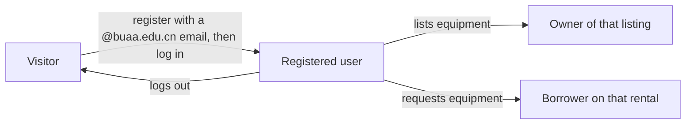

# CampusShare: User Roles and Permissions

| | |
|---|---|
| **Project** | CampusShare (team 26F) |
| **Document** | User roles and permissions |
| **Author** | Sandra Masiwa (systems design and documentation) |
| **Date** | 2026-10-18 |
| **Status** | Draft v0.1, for team review |
| **Source** | Review of `app.py` and manual testing of the running app |
| **Location** | `docs/requirements/user-roles-and-permissions.md` |

## 1. Purpose and scope

This document describes who can use CampusShare, what each kind of user is allowed to do, and where the current implementation falls short. It feeds the Software Requirements Specification (SRS), which will follow the structure of ISO/IEC/IEEE 29148.

Statements marked **(code)** come from reading `app.py`. Statements marked **(test)** come from manually using the app. Items marked **(to verify)** still need a team member to confirm by testing.

## 2. Roles

CampusShare has one account type. A user's role in a given situation depends on their relationship to a listing or rental, not on a stored field. The `users` table has no role column **(code)**.

| Role | Definition | How the system decides |
|---|---|---|
| **Visitor** | Anyone who is not logged in | No session |
| **Registered user** | A logged-in student account | A session containing `user_id` |
| **Owner (lender)** | A registered user who listed an item | `equipment.owner_id` matches the session user |
| **Borrower** | A registered user who requested an item | `borrowing_requests.borrower_id` matches the session user |
| **Administrator** | Not implemented | No such role exists **(code)** |

One person can be an owner and a borrower at the same time, on different items. A user cannot request their own item **(code)**.

## 3. Permissions

### 3.1 Public (no login required)

| Feature | Notes |
|---|---|
| Home page | |
| Register | Only emails ending in `@buaa.edu.cn` are accepted. Ownership of the email is not verified **(code, test)** |
| Log in, forgot password, reset password | Reset link is only printed to the server console **(code)** |
| Browse equipment and view item details | Listings, owner names and locations are visible without logging in **(code)** |

### 3.2 Registered user

| Feature | Conditions enforced in code |
|---|---|
| Dashboard, notifications | Own data only |
| List a new item | Available Until must not be before Available From. Past dates are accepted **(test)** |
| Request an item | Not your own item. Dates inside the availability window. No other pending or approved request on the item |
| Send chat messages, view message list | Any other registered user can be messaged |
| Delete a chat message | Only your own sent messages |
| View the student directory | Shows name and email of every other user **(code)** |
| View reviews received | Own reviews only |

### 3.3 Owner of a listing

| Feature | Conditions enforced in code |
|---|---|
| Edit or delete a listing | Must own the listing. Deleting also deletes all its requests, including approved ones **(code)** |
| Approve or reject a request | Must own the listing. The current status of the request is not checked **(code)** |
| Mark a rental as returned | Must own the listing and the request must be Approved. Late fee is calculated as late days multiplied by the listed price |
| Confirm the deposit is held | Payment status must be Paid |
| Record damage status and charge | Rental must be Completed. A description and a valid non-negative charge are required for "Damaged" |
| Refund the deposit | Rental Completed, deposit Held, and damage status "Good Condition" |

### 3.4 Borrower

| Feature | Conditions enforced in code |
|---|---|
| View own rentals | Own rentals only |
| Pay for a rental | Must be the borrower and the request must not be Rejected. This only changes a status label, there is no real payment **(code)** |
| Rate the owner | Rental must be Completed, one rating per rental, borrower only. Owners cannot rate borrowers |

## 4. Authentication and sessions (current behavior)

- Login uses email and password. Passwords are stored hashed **(code)**.
- Login state is kept in a Flask session cookie signed with a secret key that is written directly in `app.py` **(code)**.
- There is no password strength rule, no login attempt limit, and no email verification **(code, test)**.
- Unexpected logouts were observed while navigating **(test, to verify with a single account in one browser)**.

## 5. Gaps related to roles and permissions

| ID | Gap | Why it matters | Evidence |
|---|---|---|---|
| R-01 | No verification that a user owns a Beihang email or is a real student | Anyone can pose as a student, which undermines the trusted-community purpose | code, test |
| R-02 | No Administrator role | No one can resolve disputes, remove abusive users or listings, or review reports | code |
| R-03 | Owner alone decides damage status and charge | The borrower cannot dispute a charge | code |
| R-04 | Request status changes are not checked | An owner can approve a rejected request or reject an approved one | code |
| R-05 | Student directory exposes names and emails to all users | Privacy risk, made worse by R-01 | code |
| R-06 | Browse and item details are public | May be intended, but should be an explicit decision | code |
| R-07 | Secret key is hardcoded in the source | If the repository is public, session cookies and reset links could be forged | code |
| R-08 | No CSRF protection on forms | A malicious page could trigger actions for a logged-in user | code |
| R-09 | Payment is only a status change | Any borrower can mark a rental as Paid | code |
| R-10 | Deleting a listing erases its rental history | Loses records of approved and completed rentals | code |

## 6. Proposed role-related requirements (preview for the SRS)

These will be developed fully in the functional and security requirements documents.

- **SEC-01:** The system shall verify that a registering user controls the university email address, for example by sending a confirmation link.
- **SEC-02:** The system shall enforce a minimum password strength and limit repeated failed login attempts.
- **SEC-03:** The system shall load its secret key from configuration outside the source code.
- **SEC-04:** The system shall protect state-changing requests against cross-site request forgery.
- **FUN-01:** The system shall allow only valid transitions of a request's status (for example Pending to Approved or Rejected, Approved to Completed).
- **FUN-02:** The system shall provide an Administrator role able to review reports and remove listings or accounts.
- **FUN-03:** The system shall let a borrower dispute a damage charge before it is finalized.
- **PRI-01:** The system shall limit the personal information visible to other users.
